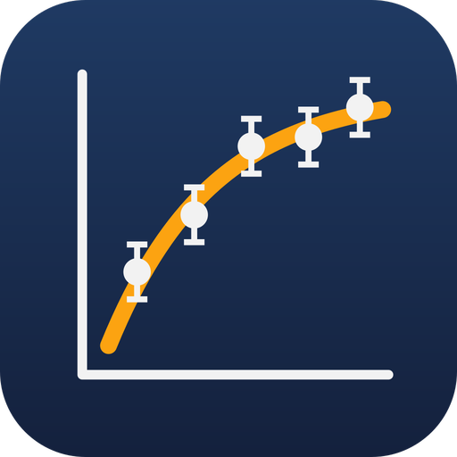
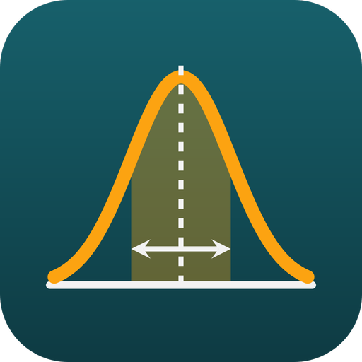

# Manual de uso

Este manual explica cómo usar las tres herramientas del proyecto:

| | Programa | Para qué |
|---|---|---|
|  | **FisGraf** | Gráficos de datos con ajustes, errores y tipografía LaTeX. |
|  | **FisErr** | Calculadora de propagación de errores. |
| ⌨ | **fisgraf-cli** | Las mismas funciones por línea de comandos y como servidor MCP, para que la use una IA. |

**Contenido**

1. [Antes de empezar](#1-antes-de-empezar)
2. [FisGraf](#2-fisgraf)
3. [FisErr](#3-fiserr)
4. [fisgraf-cli](#4-fisgraf-cli)
5. [Usarlo con una IA](#5-usarlo-con-una-ia)
6. [Referencia rápida](#6-referencia-rápida)
7. [Problemas frecuentes](#7-problemas-frecuentes)

---

## 1. Antes de empezar

### Requisitos

| Programa | Necesario para |
|---|---|
| **MiKTeX** (o TeX Live) | Vista LaTeX y exportación de gráficos en FisGraf, y el comando `grafico` de `fisgraf-cli`. FisErr no lo necesita. |
| **Rust** | Solo para compilar los programas (crear o actualizar los `.exe`). |

### Abrir los programas

| Programa | Doble clic en | Si el `.exe` no existe |
|---|---|---|
| FisGraf | `graficos\FisGraf.exe` | doble clic en `graficos\crear_ejecutable.bat` |
| FisErr | `errores\FisErr.exe` | doble clic en `errores\crear_ejecutable.bat` |

Para llevarlos a otro computador usa la carpeta `portable` (se crea con `crear_portable.bat`): sus `.exe` no necesitan instalar nada. Para un acceso directo: clic derecho sobre el `.exe` → *Enviar a* → *Escritorio*.

### Convenciones de este manual

- **σ** es la *incertidumbre estándar* (el «error» de una medición, una desviación estándar).
- Todo texto que aparece en los gráficos se escribe en **LaTeX**: `$T_0$`, `[\unit{m/s^2}]`. Lo que no va entre `$…$` es texto normal.
- Las ecuaciones se escriben en **sintaxis calculable**: `2*pi*sqrt(L/g)`. Ver [§6.1](#61-cómo-escribir-ecuaciones).

---

## 2. FisGraf

FisGraf toma mediciones de un Excel o un CSV, ajusta modelos teóricos, calcula el error de cada parámetro y genera un gráfico con calidad de publicación en LaTeX.

### 2.1 La ventana

```
┌──────────────────────────────────────────────────────────────────┐
│ Archivo  Editar                                    Calculado …   │  ← menú
├──────────────────────┬───────────────────────────────────────────┤
│ Datos Series Ajustes │  [Vista rápida] [Vista LaTeX]             │
│ Referencias Ejes     │                                           │
│ Estilo Exportar      │          vista previa del gráfico         │
│ Propagación          │                                           │
│                      │                                           │
│  (opciones de la     │                                           │
│   pestaña elegida)   │                                           │
├──────────────────────┴───────────────────────────────────────────┤
│ [Resultados] [Mensajes]   parámetros, R², χ², avisos…            │  ← panel inferior
└──────────────────────────────────────────────────────────────────┘
```

- **Izquierda:** las pestañas de configuración.
- **Centro:** la vista previa.
  - **Vista rápida:** instantánea y aproximada.
  - **Vista LaTeX:** el gráfico final compilado; tarda unos segundos y se actualiza sola.
- **Abajo:**
  - **Resultados:** cada ajuste con sus parámetros, errores y estadísticos.
  - **Mensajes:** avisos y errores (por ejemplo, una celda del Excel que no es un número).

Los paneles se pueden agrandar arrastrando sus bordes. Los cálculos corren en segundo plano: la ventana nunca se congela.

### 2.2 Primer gráfico en 6 pasos

1. **Datos** → *Abrir Excel…* → elige tu archivo (`.xlsx`, `.xls`, `.ods` o `.csv`).
2. En la tabla, **selecciona las columnas** x, y y (si tienes) σy: haz clic en la primera celda de datos y **Mayús+clic** en la última. Pulsa **Crear serie con la selección**.
3. **Ajustes** → *+ Nuevo ajuste* → escribe la ecuación (p. ej. `a*x + b`) → **Actualizar parámetros**.
4. **Ejes** → escribe los títulos, p. ej. `Tiempo $t$ [\unit{s}]`.
5. Mira la **Vista LaTeX** y los **Resultados** abajo.
6. **Exportar** → elige los formatos → **Exportar**.

Guarda el proyecto con **Ctrl+S**. Se guarda como `.fisgraf.json`, junto con la ruta del Excel.

### 2.3 Menús y atajos

| Menú | Opción | Atajo |
|---|---|---|
| Archivo | Nuevo | Ctrl+N |
| | Abrir… | Ctrl+O |
| | Abrir ejemplo ▸ (proyectos de `graficos/examples`) | |
| | Abrir datos de prueba ▸ (8 experimentos simulados) | |
| | Guardar / Guardar como… | Ctrl+S / Ctrl+Mayús+S |
| | Salir | |
| Editar | Deshacer / Rehacer | Ctrl+Z / Ctrl+Y |

Si hay cambios sin guardar, el título de la ventana muestra **●** y el programa pregunta antes de cerrar o de abrir otro proyecto.

### 2.4 Pestaña Datos

Abre el archivo de mediciones y elige las celdas.

| Opción | Qué hace |
|---|---|
| **Abrir Excel…** | Elige el archivo: `.xlsx`, `.xlsm`, `.xls`, `.xlsb`, `.ods`, `.csv`, `.tsv` o `.txt`. |
| **Recargar** | Vuelve a leer el archivo si lo editaste por fuera. |
| **Hoja** | Hoja que se muestra en la tabla. |
| **Tabla de celdas** | Clic en una celda y **Mayús+clic** en otra para seleccionar un rango. Clic en la **letra de una columna** la selecciona desde la fila 2 hasta el final. |
| **Hasta el final de la columna (B2:B)** | El rango crece solo si agregas filas al Excel. |
| **→ x · → y · → σx · → σy** | Asigna la selección a la serie elegida en la pestaña Series. |
| **Crear serie con la selección** | Con 2 columnas: x, y. Con 3: x, y, σy. El nombre sale del encabezado. |

Los rangos de la serie elegida se resaltan: **x en azul**, **y en rojo** y los **errores en gris**.

> **CSV:** el separador (`,`, `;` o tabulador) se detecta solo. Con `;` se admite la coma decimal (`0,96`). En el Excel, los números escritos como texto con coma decimal también se leen.

### 2.5 Pestaña Series

Cada serie es un conjunto de mediciones con su propio estilo y entrada en la leyenda.

| Opción | Qué hace |
|---|---|
| **+ Nueva serie / Duplicar / Eliminar / ↑ ↓** | Administrar y ordenar las series. |
| **Leyenda (LaTeX)** | Texto en la leyenda; debajo se ve cómo se leerá. |
| **Visible · En la leyenda** | Ocultar la serie, o dejarla fuera de la leyenda. |
| **Rango x · Rango y** | Celdas de los datos, p. ej. `Hoja1!A2:A20` o `A2:A`. Un ✔ verde o una ✖ roja indican si el rango es válido. |
| **Error de x · Error de y** | Cómo se da el error (ver la tabla siguiente). |
| **Color · Marcador · tamaño** | ● ■ ▲ ◆ × + ★ o ninguno, con su tamaño en pt. |
| **Dibujo** | **Solo puntos**, o **puntos con barras de error** (la cruz con topes, por defecto). Solo cambia el gráfico: los ajustes siguen usando los errores para ponderar. |
| **Topes de error** | Largo de la línea al final de cada barra de error (0 = sin tope). Solo se puede cambiar con barras de error. |
| **Unir puntos** | Línea que une los puntos, con su color, trazo, grosor y opacidad. |

**Formas de indicar el error:**

| Tipo | Significado |
|---|---|
| Sin error | No se dibujan barras. |
| Columna del Excel | Un error por medición, desde un rango. |
| Constante | El mismo σ para todas las mediciones. |
| Porcentaje | σ = un % del valor medido. |
| Resolución del instrumento | σ = resolución / (2√3), según la GUM (distribución uniforme). |

Debajo del editor se indica el estado de la serie: «✔ 9 puntos (1 fila vacía descartada)», o el error con la celda exacta.

### 2.6 Pestaña Ajustes (líneas de tendencia)

Ajusta una ecuación teórica a una o varias series.

**Lista y datos generales**

| Opción | Qué hace |
|---|---|
| **+ Nuevo ajuste / Duplicar / Eliminar** | Administrar ajustes; la casilla a la izquierda lo activa o desactiva. |
| **Leyenda (LaTeX) · En la leyenda** | Texto en la leyenda. |
| **Aplicar a** | Series a las que se ajusta (un ajuste independiente por serie). |

**Modelo teórico**

| Opción | Qué hace |
|---|---|
| **Ecuación** | P. ej. `A*exp(-t/tau) + B`. Debajo se ve en LaTeX, o el error si está mal escrita. |
| **Variable medida** | El nombre de la variable independiente (`t`). |
| **LaTeX propio** | Para escribir la ecuación a mano en vez de usar la conversión automática. |
| **Actualizar parámetros** | Crea la lista de parámetros a partir de la ecuación. |
| **Copiar LaTeX** | Copia la ecuación en LaTeX. |

**Tabla de parámetros**

| Columna | Qué es |
|---|---|
| Inicial | Valor de partida. Importa en modelos no lineales: pon algo del orden correcto. |
| Fijo | El parámetro no se ajusta; queda en el valor inicial. |
| Límites (mín, máx) | Rango permitido (opcional). |
| Símbolo LaTeX | P. ej. `\omega_0`; vacío = automático. |
| Unidad (siunitx) | P. ej. `m/s^2`, `\ohm`, `\degreeCelsius`. |

**Método de ajuste:** *Automático* (recomendado), *Mínimos cuadrados lineales*, *Levenberg–Marquardt*, *Gauss–Newton*, *Nelder–Mead + LM*, *Varianza efectiva* u *ODR*. Ver [§6.2](#62-qué-método-elegir).

- **Opciones avanzadas:** iteraciones máximas, tolerancia y **usar pesos 1/σ²** (activado por defecto si hay errores).

**Incertidumbre de los parámetros**

| Opción | Qué hace |
|---|---|
| **Método** | *Matriz de covarianza*, *Bootstrap*, *Monte Carlo*, *Jackknife* o *Perfil de χ²*. |
| **Covarianza** | *Absoluta* si tus σ son confiables; *Escalada por χ²_red* si no lo son. |
| **Re-muestreo** (bootstrap) | Residuos o pares (x, y). |
| **Muestras · Semilla** | Para bootstrap y Monte Carlo; con semilla fija, el resultado se puede reproducir. |
| **Nivel de confianza** | Para los intervalos y la banda (95 % por defecto). |

**Curva en el gráfico**

| Opción | Qué hace |
|---|---|
| Color, trazo, grosor, opacidad | Estilo de la línea. *Color de la serie* hereda el color de los datos. |
| **Banda de confianza** | Sombrea la zona donde está la curva verdadera, con su opacidad. |
| **Dominio manual** | Dibuja la curva más allá (o más acá) de los datos. |
| **Puntos de la curva** | Más puntos dan una curva más suave. |
| **Agregar R² a la leyenda** | Escribe «(R² = 0,9987)» junto al nombre del ajuste. |

**Cuadro de resultados del gráfico:** marca **Incluir este ajuste en el cuadro** y elige qué escribir:

| Opción | Ejemplo en el gráfico |
|---|---|
| Ecuación con los valores ajustados (+ lado izquierdo) | `y = 0,13 t + 4,935 t²` |
| Parámetros con su error | `g = (9,87 ± 0,12) m/s²` |
| R² · R² ajustado | `R² = 0,99984` |
| χ²_red · χ² · p-valor | `χ²_ν = 0,90` |
| s (residuos) · n y ν | `s = 1,15` · `n = 10, ν = 8` |
| Título | El nombre del ajuste (y de la serie, si hay varias). |

El cuadro solo aparece si además está activado en **Estilo → Cuadro de resultados**; si no lo está, la pestaña lo avisa. Al final de la pestaña se indica el estado del ajuste: «✔ convergió en 7 iteraciones · χ²_red = 0,86», o el problema.

### 2.7 Pestaña Referencias

Curvas teóricas **fijas**, sin ajuste, para comparar con los datos (p. ej. «Modelo teórico» o «0,987·T_teo»).

| Opción | Qué hace |
|---|---|
| **+ Nueva referencia / Duplicar / Eliminar** | La casilla la muestra u oculta. |
| **Leyenda · En la leyenda** | Vacío = la ecuación en LaTeX. |
| **Ecuación · Variable · LaTeX propio** | Como en los ajustes. |
| **Constantes** | Valores de los nombres de la ecuación. **Agregarlas** crea las que faltan. |
| **Curva** | Color, trazo (continua, discontinua, punteada…), grosor y opacidad. |
| **Dominio manual · Puntos** | Por defecto la curva cubre todo el eje x. |

### 2.8 Pestaña Ejes

Hay una sección para el eje **x** y otra para el **y**.

| Opción | Qué hace |
|---|---|
| **Título (LaTeX)** | P. ej. `Periodo $T$ [\unit{s}]`. |
| **Límites** | Mínimo y máximo manuales (si no, automáticos). |
| **Escala** | Lineal o logarítmica. |
| **Marcas** | *Automáticas*, *Cada…* (una distancia fija) o *En posiciones* (`1; 2,5; 4`). |
| **Menores entre principales** | Marcas pequeñas intermedias. |
| **Dirección** | Hacia dentro, hacia fuera o a ambos lados. |
| **Números** | Notación (automática, decimal `0,95` o científica `9,5·10⁻¹`), **decimales**, completar con ceros, **coma decimal**, separar miles y factor común ×10ⁿ. |

> La coma decimal del **eje y** se usa en todo el gráfico: ecuaciones, unidades y cuadro de resultados.

### 2.9 Pestaña Estilo

| Opción | Qué hace |
|---|---|
| **Título** | Título del gráfico (vacío = sin título). |
| **Ancho** | En cm; abajo se ve el tamaño resultante. |
| **Proporción** | 4:3, 3:2, 16:9, 9:16 (vertical), 1:1, áurea o personalizada. |
| **Fuente · Tamaño** | Latin Modern (la clásica de LaTeX), Times, Palatino, Libertine, Charter, Fira Sans o cualquier fuente instalada (con LuaLaTeX). |
| **Motor LaTeX** | LuaLaTeX (recomendado) o pdfLaTeX. |
| **Cuadrícula** | Principal o secundaria, con su color y opacidad. |
| **Leyenda** | Mostrar u ocultar; posición (cuatro esquinas, fuera a la derecha, debajo del gráfico o personalizada x/y), columnas, marco y opacidad del fondo. |
| **Cuadro de resultados** | Mostrar y posición (mismas opciones que la leyenda). |
| **Residuos** | Agrega debajo un panel con los residuos de los ajustes. |
| **Preámbulo LaTeX adicional** | Paquetes o macros extra, p. ej. `\usepackage{physics}`. |

### 2.10 Pestaña Exportar

| Opción | Qué hace |
|---|---|
| **Carpeta de salida** | *Elegir carpeta…* o *Junto al proyecto*; *Abrir carpeta* la muestra en el Explorador. |
| **Nombre del archivo** | Sin extensión. |
| **PDF** | Vectorial; ideal para LaTeX o para imprimir. |
| **PNG** | Imagen, con la resolución que elijas (300 ppp por defecto). |
| **SVG** | Vectorial, para web o Word. |
| **.tex completo** | Documento compilable con el gráfico. |
| **Fragmento tikzpicture** | Solo el gráfico, para `\input{}` en tu informe. El archivo indica qué paquetes necesita. |
| **Exportar** | Compila y guarda; al terminar lista los archivos con un botón *Abrir*. |
| **Copiar código tikzpicture** | Copia el gráfico en LaTeX sin escribir archivos. |

### 2.11 Pestaña Propagación

Es la misma calculadora de errores que FisErr ([§3](#3-fiserr)), pero guardada dentro del proyecto. Sirve, por ejemplo, para calcular h a partir de la pendiente de un ajuste.

### 2.12 Panel de resultados

Para cada ajuste y serie muestra:

- el método usado, las iteraciones y si se usaron pesos;
- una tabla con cada parámetro: **valor ± σ** (redondeado según la GUM), σ (o −σ/+σ en el perfil de χ²) y el intervalo de confianza;
- los estadísticos: **χ²**, grados de libertad **ν**, **χ²_red**, **p-valor**, **R²**, **s** y **AIC/BIC**;
- la **correlación entre parámetros**, en naranja si |ρ| > 0,95 (parámetros muy correlacionados);
- los botones **Copiar tabla LaTeX** y **Copiar texto**.

### 2.13 Proyectos de ejemplo y datos de prueba

- **Archivo → Abrir ejemplo**: imanes, péndulo, Hooke y decaimiento radiactivo.
- **Archivo → Abrir datos de prueba**: 8 experimentos simulados, cada uno mostrando opciones distintas (caída libre, ley de Ohm, carga RC, oscilador amortiguado, enfriamiento de Newton, resonancia RLC, efecto fotoeléctrico y ley de Boyle).
  - Cada Excel trae una hoja **Notas** con los valores reales, para comparar.
  - La guía está en `graficos/datos_de_prueba/README.md`.

---

## 3. FisErr

FisErr calcula el **error de una magnitud** a partir de mediciones: escribes la ecuación teórica, indicas cuáles son las variables medidas (con su error) y cuáles las constantes, y obtienes el **valor final con su error** y la **función del error**.

### 3.1 La ventana

- **Izquierda:** la lista de cálculos (*+ Nuevo*, *Duplicar*, *Eliminar*).
- **Derecha:** la calculadora: datos arriba y resultado abajo.
- **Abajo:** mensajes (archivo guardado, errores).

### 3.2 Paso a paso

1. **Magnitud:** el nombre del resultado (`g`), su símbolo LaTeX (opcional) y su unidad (`m/s^2`).
2. **Ecuación:** p. ej. `4*pi^2*L/T^2`. Pulsa **Detectar variables**.
3. En la tabla, para cada nombre:

   | Columna | Qué poner |
   |---|---|
   | Tipo | **Variable medida** (tiene error) o **Constante** (exacta). |
   | Valor | El valor medido o la constante. |
   | σ | Incertidumbre estándar (solo variables medidas). |
   | Distribución | **Normal** (por defecto), **Uniforme** (resolución de un instrumento) o **Triangular**. Solo la usa Monte Carlo. |
   | Símbolo LaTeX · Unidad | Opcionales; para la fórmula en LaTeX. |

   > Con la resolución r de un instrumento (p. ej. una regla de 1 mm): σ = r/(2√3) ≈ 0,29 mm, distribución uniforme.

4. **Correlaciones** (opcional): solo si dos mediciones no son independientes (p. ej. comparten el instrumento). Elige las dos variables y su ρ, entre −1 y 1.
5. **Método**: lineal (el estándar), segundo orden, Monte Carlo, Kragten o cota máxima. Ver [§6.2](#62-qué-método-elegir).
6. **Nivel de confianza** para la incertidumbre expandida (95 % por defecto).
   - **Opciones de Monte Carlo:** número de muestras (200 000 por defecto) y semilla fija.

### 3.3 El resultado

| Sección | Qué muestra |
|---|---|
| **Resultado** (en verde) | `g = 9,80 ± 0,05 m/s²`, redondeado según la GUM. |
| Error relativo · incertidumbre expandida | `0,50 %` · `U = 0,096 m/s² (95 %, k = 1,96)`. En Monte Carlo: el intervalo de cobertura. |
| **Función final con su error** | f(x) y **σ_f(x)** en forma simbólica, p. ej. `σ_g = √((4π²/T²)²·σ_L² + (−8π²L/T³)²·σ_T²)`. |
| **Comparación de métodos** | Valor, σ e intervalo según los 5 métodos. Si difieren mucho, f no es lineal en el rango de tus errores: confía en Monte Carlo. |
| **Presupuesto de incertidumbre** | Cuánto aporta cada medición al error final. Para mejorar el resultado, mejora primero la medición con mayor %. |
| **Distribución de Monte Carlo** | Histograma de los valores simulados, con el intervalo y la media. |
| **Derivadas parciales** | ∂f/∂xᵢ de cada variable. |

**Botones para copiar:**

| Botón | Qué copia |
|---|---|
| Copiar resultado LaTeX | `$g = \left(9{,}80 \pm 0{,}05\right)\,\unit{m/s^2}$` |
| Copiar fórmula de propagación | Un entorno `align*` con f, σ_f y cada derivada, listo para el informe. |
| Copiar σ_f en LaTeX | Solo la función del error. |
| Copiar texto | `g = 9,80 ± 0,05 m/s^2` |

### 3.4 Menús y archivos

| Menú | Opción |
|---|---|
| Archivo | Nuevo (Ctrl+N), Abrir… (Ctrl+O), Guardar (Ctrl+S), Salir |
| Ejemplos | Péndulo, densidad de un cilindro, resistencias en paralelo, energía cinética, ley de Snell y constante de un resorte |
| Ver | Coma decimal (`9,80`) o punto (`9.80`) |

Los cálculos se guardan como `.fiserr.json`, que puede contener varios. Si hay cambios sin guardar, el título muestra **●**.

---

## 4. fisgraf-cli

Programa de línea de comandos con las mismas funciones, pensado para scripts y para que una IA lo use como herramienta. Recibe y devuelve **JSON**.

**Dónde conseguirlo:** `fisgraf-cli.exe` está en la página de descargas del repositorio. También puedes compilarlo con `cargo build --release -p fisgraf --bin fisgraf-cli` (queda en `target\release\`). Con `fisgraf-cli mcp` funciona como servidor MCP (sección 5).

| Comando | Qué hace |
|---|---|
| `fisgraf-cli errores entrada.json` | Propagación de errores. |
| `fisgraf-cli ajustar entrada.json` | Ajuste de un modelo a datos. |
| `fisgraf-cli grafico proyecto.fisgraf.json` | Genera el gráfico e informa los ajustes. |
| `fisgraf-cli plantilla errores` (o `ajustar`, `grafico`) | Imprime un JSON de ejemplo listo para editar. |
| `fisgraf-cli ayuda` | Ayuda resumida. |

En lugar de un archivo se puede pasar `-` para leer el JSON de la entrada estándar. Si algo falla, la respuesta es `{"error": "…"}` con un mensaje en español.

### 4.1 `errores`

```json
{
  "nombre": "g", "unidad": "m/s^2",
  "ecuacion": "4*pi^2*L/T^2",
  "variables": { "L": { "valor": 1.0, "sigma": 0.0003, "distribucion": "uniforme" }, "T": [2.007, 0.005] },
  "constantes": {},
  "metodo": "lineal"
}
```

| Campo | Valores |
|---|---|
| `variables` | `[valor, sigma]` o `{valor, sigma, distribucion, unidad, latex}` |
| `constantes` | `{"nombre": valor}` |
| `correlaciones` | `[{"a": "x", "b": "y", "rho": 0.3}]` |
| `metodo` | `lineal`, `segundo_orden`, `monte_carlo`, `kragten`, `cota_maxima` |
| `nivel`, `muestras`, `coma_decimal` | Nivel de confianza, muestras de Monte Carlo, coma o punto |

**Respuesta:**
- `resultado` (`"g = 9,80 ± 0,05 m/s^2"`), `resultado_latex`, `valor`, `sigma`, `error_relativo_pct`, `intervalo`;
- `funcion_error` y `funcion_error_latex` (σ_f simbólica), `formula_latex`, `derivadas`;
- `metodos` (los 5), `presupuesto` y `avisos`.

### 4.2 `ajustar`

```json
{
  "datos": { "x": [1, 2, 3, 4], "y": [2.1, 3.9, 6.2, 7.8], "sy": [0.2, 0.2, 0.2, 0.2] },
  "modelo": "a*x + b", "parametros": { "a": 1, "b": 0 }
}
```

| Campo | Valores |
|---|---|
| Datos | `datos` en línea, **o** `archivo` (CSV o Excel, relativo al JSON) con rangos `x`, `y`, `sx`, `sy` (`"A2:A"`, `"Hoja1!B2:B"`) |
| `modelo`, `variable` | Ecuación y variable independiente (`x` por defecto) |
| `parametros` | `{"a": 1}` (valor inicial) o `{"a": {"inicial": 1, "min": 0, "max": 10, "fijo": false, "unidad": "m"}}` |
| `metodo` | `auto`, `lineal`, `levenberg_marquardt`, `gauss_newton`, `nelder_mead`, `varianza_efectiva`, `odr` |
| `incertidumbre` | `covarianza`, `bootstrap`, `monte_carlo`, `jackknife`, `perfil` |
| `covarianza` | `escalada` (por defecto) o `absoluta` |
| `nivel`, `usar_pesos`, `coma_decimal` | |

**Respuesta:** `parametros` (con `valor`, `sigma`, `intervalo` y `texto` redondeado), `estadisticos` (`chi2`, `chi2_red`, `p_valor`, `r2`, `r2_ajustado`, `s_residuos`, `aic`, `bic`, `gl`), `correlacion`, `residuos` y `avisos`.

### 4.3 `grafico`

```bash
fisgraf-cli grafico proyecto.fisgraf.json --formatos pdf,png --salida graficos_finales --dpi 300
```

| Opción | Qué hace |
|---|---|
| `--formatos` | Cualquier combinación de `pdf`, `png`, `svg`, `tex`, `tikz` (si no se da, se usan los del proyecto). |
| `--salida DIR` | Carpeta de salida (si no, junto al proyecto). |
| `--dpi N` | Resolución del PNG. |

El proyecto es el mismo `.fisgraf.json` que guarda FisGraf: puedes crearlo en la aplicación y generarlo desde la terminal, o escribirlo a mano. `fisgraf-cli plantilla grafico` da un proyecto mínimo, y el formato completo está en `plugin/skills/fisgraf/referencia.md`.

---

## 5. Usarlo con una IA

Una IA puede usar `fisgraf-cli` como herramienta: obtiene los mismos números que las aplicaciones, redondeados según la GUM, y los gráficos con el mismo estilo LaTeX. Basta con pedir lo que necesitas, por ejemplo:

- «Calcula el error de g = 4π²L/T² con L = 1,000 ± 0,001 m y T = 2,007 ± 0,005 s».
- «Ajusta los datos de `mediciones.xlsx` (columnas A y B, errores en C) a una exponencial y dame τ con su error».
- «Haz un gráfico con barras de error, la recta ajustada y R² de estos datos: …».
- «¿Qué medición domina el error de la densidad?».

La IA informará los resultados (con χ²_red y R² cuando corresponda) y te entregará los archivos del gráfico. Para retocar un gráfico, abre con FisGraf el `.fisgraf.json` que haya creado.

| Dónde | Cómo se instala |
|---|---|
| **Claude Code** (terminal o pestaña *Code*) | Plugin: `/plugin marketplace add malvarezdam/Errores-y-Gr-ficos` y después `/plugin install fisgraf@errores-y-graficos`. La primera vez descarga `fisgraf-cli.exe` en `%USERPROFILE%\.fisgraf\`. |
| **Un solo proyecto de Claude Code** | Descomprime `FisGraf-para-Claude.zip` (de la página de descargas) en la raíz del proyecto: queda `.claude\skills\fisgraf\` con el `.exe` incluido. |
| **Claude Desktop, Cursor, VS Code y otras** | Servidor MCP. En PowerShell: `irm https://raw.githubusercontent.com/malvarezdam/Errores-y-Gr-ficos/main/instalar.ps1 \| iex`. Descarga la herramienta y, si tienes Claude Desktop, la registra; reinícialo después. Para otras apps, el servidor es `fisgraf-cli.exe` con el argumento `mcp`. |

Para desactivarlo: `/plugin uninstall fisgraf`, borra la carpeta `.claude\skills\fisgraf\` del proyecto, o quita la entrada `fisgraf` de la configuración MCP.

---

## 6. Referencia rápida

### 6.1 Cómo escribir ecuaciones

| Elemento | Cómo se escribe |
|---|---|
| Operaciones | `+ - * / ^` (también `**`). La multiplicación puede ir implícita: `2pi`, `2(x+1)` |
| Funciones | `sin cos tan asin acos atan sinh cosh tanh exp ln log10 sqrt abs` |
| Constantes | `pi`, `e` |
| Logaritmo | **`log` = logaritmo natural** (igual que `ln`); base 10: `log10` |
| Ángulos | En radianes; para grados: `sin(t*pi/180)` |
| Potencias | `-x^2` es −(x²); `2^3^2` = 2⁹ |
| Nombres | `omega` → ω, `T0` → T₀, `T_teo` → T_teo (se convierten solos a LaTeX) |

### 6.2 Qué método elegir

**Ajuste**

| Método | Úsalo cuando… |
|---|---|
| Automático | No sabes cuál: decide según el modelo y los errores. |
| Mínimos cuadrados lineales | El modelo es lineal en los parámetros (rectas, polinomios). |
| Levenberg–Marquardt | El caso general no lineal. |
| Nelder–Mead + LM | Los valores iniciales están lejos de la solución. |
| Varianza efectiva / ODR | Hay errores en x y en y; ODR es el tratamiento más riguroso. |

**Incertidumbre de parámetros**

| Método | Úsalo cuando… |
|---|---|
| Matriz de covarianza | Casi siempre. |
| Bootstrap | No quieres suponer errores normales. |
| Monte Carlo | Quieres propagar los σ de tus datos. |
| Jackknife | Quieres ver cuánto depende el resultado de cada punto. |
| Perfil de χ² | El modelo es muy no lineal: da errores asimétricos −σ/+σ. |

**Propagación de errores**

| Método | Úsalo cuando… |
|---|---|
| Lineal (derivadas parciales) | Casi siempre: σ_f = √(Σ (∂f/∂xᵢ)² σᵢ²). |
| Segundo orden | f es muy curva o los errores relativos son grandes. |
| Monte Carlo | Quieres el resultado más fiable sin suponer linealidad. |
| Kragten | Quieres el equivalente numérico del lineal (EURACHEM). |
| Cota máxima | Te piden el «error máximo»; es una cota, no una σ. |

### 6.3 Cómo leer los resultados

| Indicador | Interpretación |
|---|---|
| **χ²_red ≈ 1** | El modelo y los errores son coherentes. |
| **χ²_red ≫ 1** | Errores subestimados, o el modelo no describe los datos. |
| **χ²_red ≪ 1** | Errores sobrestimados. |
| **p-valor** | Probabilidad de un χ² igual o peor si el modelo es correcto; < 0,05 es sospechoso. |
| **R²** | Qué fracción de la variación de y explica el modelo (1 = perfecto). Por sí solo no garantiza un buen ajuste: mira también χ²_red y los residuos. |
| **Residuos** | Deben repartirse al azar alrededor de 0. Si muestran una forma, el modelo no es el adecuado. |
| **Correlación \|ρ\| > 0,95** | Dos parámetros casi no se pueden separar con estos datos. |

**Redondeo (GUM):** la incertidumbre se da con 1 o 2 cifras significativas (regla del PDG) y el valor se redondea a la misma posición decimal: `9,793 ± 0,021`, `239 ± 4`.

---

## 7. Problemas frecuentes

| Problema | Solución |
|---|---|
| «no se encontró lualatex» | Instala MiKTeX y reinicia el programa. |
| La primera compilación tarda o se queda esperando | MiKTeX está instalando paquetes o pidiendo permiso para hacerlo. Abre *MiKTeX Console* → *Settings* y elige «Always install missing packages». |
| «error de LaTeX en la línea N» | Hay un error en algún texto del gráfico. Escribe `\%` en vez de `%`, y `\_` para un guion bajo fuera de `$…$`. El mensaje muestra el texto problemático. |
| «la celda Hoja1!B7 contiene «abc», que no es un número» | El rango incluye un encabezado o texto: empieza una fila más abajo. |
| El ajuste no converge | Acerca los valores iniciales, prueba Nelder–Mead + LM o pon límites a los parámetros. |
| La leyenda o el cuadro tapan los datos | Cambia su posición en *Estilo*. Con *Personalizada* puedes ubicarlos exactamente. |
| «Parámetros en la ecuación: …» | Cambiaste la ecuación: pulsa **Actualizar parámetros** (o **Detectar variables** en FisErr). |
| El Excel cambió y no se ve | **Datos → Recargar**. |
