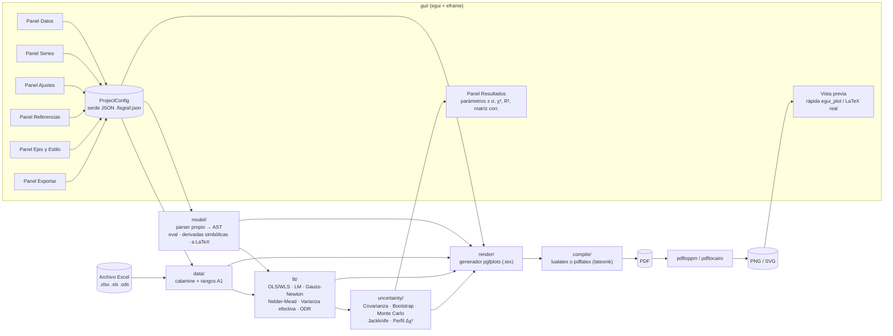

# FisGraf — Plan del proyecto

Programa de escritorio en **Rust + egui** que lee datos desde Excel, ajusta modelos
teóricos con varios métodos numéricos, calcula las incertidumbres de los parámetros y
genera gráficos de calidad de publicación con **LaTeX (pgfplots)**.

---

## 1. Entorno verificado (27-10-2026)

| Herramienta | Estado |
|---|---|
| Rust / Cargo | 1.97.1 ✅ |
| MiKTeX 25.12 (`pdflatex`, `lualatex`, `xelatex`, `latexmk`) | ✅ |
| Paquetes `pgfplots`, `siunitx`, `fontspec`, `lmodern`, `newtxmath`, `standalone` | ✅ |
| `pdftoppm` / `pdftocairo` (incluidos en MiKTeX; PDF → PNG/SVG) | ✅ |
| Git | 2.55 ✅ |

---

## 2. Arquitectura



### Estructura de carpetas

```
fisgraf/
├─ Cargo.toml
├─ src/
│  ├─ main.rs                 # arranque eframe
│  ├─ config/                 # ProjectConfig, SeriesConfig, AxisConfig… (serde)
│  ├─ data/
│  │  ├─ excel.rs             # calamine: hojas, celdas, lectura de rangos
│  │  └─ range.rs             # "Hoja1!B2:B20" ↔ coordenadas
│  ├─ model/
│  │  ├─ parser.rs            # texto → AST (x, parámetros, constantes, funciones)
│  │  ├─ eval.rs              # evaluación numérica
│  │  ├─ diff.rs              # derivadas simbólicas ∂f/∂p, ∂f/∂x
│  │  └─ latex.rs             # AST → LaTeX (\sqrt{}, \frac{}{}, subíndices)
│  ├─ fit/
│  │  ├─ linear.rs            # OLS / WLS por QR-SVD (modelos lineales en parámetros)
│  │  ├─ lm.rs                # Levenberg–Marquardt (variante de Moré, escalado)
│  │  ├─ gauss_newton.rs      # con búsqueda lineal
│  │  ├─ nelder_mead.rs       # sin derivadas, para semillas malas
│  │  ├─ effective_var.rs     # varianza efectiva (errores en x e y)
│  │  └─ odr.rs               # regresión de distancia ortogonal (estilo ODRPACK)
│  ├─ uncertainty/
│  │  ├─ covariance.rs        # (JᵀWJ)⁻¹, σ absoluta o escalada por χ²_red
│  │  ├─ bootstrap.rs         # residuos y pares, intervalos percentil
│  │  ├─ monte_carlo.rs       # propagación de σx, σy
│  │  ├─ jackknife.rs
│  │  ├─ profile.rs           # perfil Δχ² = 1 (errores asimétricos)
│  │  └─ stats.rs             # χ², χ²_red, p-valor, R², AIC/BIC, bandas de confianza
│  ├─ render/
│  │  ├─ pgfplots.rs          # genera el .tex
│  │  ├─ format.rs            # formato numérico, redondeo de incertidumbres
│  │  ├─ compile.rs           # llama al motor LaTeX, interpreta el .log
│  │  └─ convert.rs           # pdftoppm / pdftocairo
│  └─ gui/
│     ├─ app.rs               # estado, guardado/carga, deshacer
│     ├─ panels/              # datos, series, ajustes, referencias, ejes, estilo, exportar
│     ├─ preview.rs           # vista rápida + vista LaTeX (hilo en segundo plano)
│     └─ results.rs
├─ tests/                     # incluye validación NIST StRD
└─ examples/                  # Excel y proyectos de ejemplo (péndulo, Hooke, decaimiento)
```

---

## 3. Decisiones técnicas

### 3.1 Ecuaciones
- El modelo se escribe con **sintaxis calculable**: `2*pi*sqrt((L + a)/g)`.
  En el formulario se indica cuál es la **variable medida** (p. ej. `L`) y cuáles son los
  **parámetros por ajustar** (p. ej. `a`, `g`), cada uno con su valor inicial y límites opcionales.
- El programa **convierte automáticamente** la expresión a LaTeX (`2\pi\sqrt{\frac{L+a}{g}}`)
  y también deja editar la etiqueta LaTeX a mano.
- Se usa un **parser propio** (AST) en lugar de una librería, porque así controlamos la evaluación,
  las derivadas simbólicas (Jacobiano exacto, sin diferencias finitas) y la conversión a LaTeX.
- Funciones: `sin cos tan asin acos atan sinh cosh tanh exp ln log10 sqrt abs pow`; constantes `pi`, `e`.
- Si el modelo es lineal en los parámetros (se detecta en el AST), se ofrece el ajuste lineal exacto.

### 3.2 Métodos de ajuste (seleccionables por ajuste)
| Método | Cuándo usarlo |
|---|---|
| **Mínimos cuadrados lineales (OLS/WLS)** vía QR/SVD | Modelos lineales en los parámetros (rectas, polinomios). Solución exacta. |
| **Levenberg–Marquardt** *(por defecto)* | Estándar para modelos no lineales (igual que `scipy.curve_fit`, MINPACK, gnuplot `fit`). |
| **Gauss–Newton con búsqueda lineal** | Problemas bien condicionados con buena semilla. |
| **Nelder–Mead** | Sin derivadas. Sirve con semillas malas; luego se refina con LM. |
| **Varianza efectiva** | Hay errores en x y en y: σ²_ef = σy² + (∂f/∂x · σx)², iterativo. Muy usado en laboratorios de física. |
| **ODR (distancia ortogonal)** | Hay errores en x e y comparables. Es el tratamiento riguroso (ODRPACK / `scipy.odr`). |

Todos admiten **pesos 1/σ²** cuando hay columnas de error. Las barras de error se pueden dar como columna, constante, porcentaje o resolución del instrumento.

### 3.3 Métodos de incertidumbre (seleccionables)
| Método | Notas |
|---|---|
| **Matriz de covarianza** *(por defecto)* | (JᵀWJ)⁻¹. Hay dos modos: σ absoluta (cuando los errores son conocidos) o escalada por χ²_red. Es la misma opción que `absolute_sigma` en SciPy. |
| **Bootstrap** (residuos / pares) | N configurable, intervalo percentil. Robusto y no supone normalidad. |
| **Monte Carlo** | Re-muestrea los datos según σx y σy y vuelve a ajustar. |
| **Jackknife** | Deja fuera un punto cada vez. |
| **Perfil de χ² (Δχ² = 1)** | Errores **asimétricos** en modelos fuertemente no lineales. |

Salida: valor ± σ, intervalo de confianza con *t* de Student, matriz de correlación, χ², χ²_red, p-valor, R², AIC/BIC y residuos. Además, **redondeo según la GUM** (1–2 cifras significativas en la incertidumbre) y banda de confianza opcional en el gráfico.

**Validación:** los ajustadores se prueban contra los conjuntos certificados **NIST StRD** (Misra1a, Thurber, MGH09, etc.).

### 3.4 Gráfico LaTeX (pgfplots)
- Documento `standalone`. Motor **lualatex** por defecto (permite cualquier fuente del sistema mediante `fontspec`), con `pdflatex` como alternativa.
- Las tendencias y las funciones de referencia se **muestrean en Rust** y se escriben como tablas. Así se evitan los problemas de precisión de `pgfmath` y lo dibujado coincide exactamente con el cálculo.
- Opciones: título, etiquetas de ejes en LaTeX, cuadrícula mayor/menor, mínimos y máximos manuales, escala log, ticks (distancia, número de menores, lista manual), formato numérico de ejes (fijo/científico, decimales, coma decimal), proporción (4:3, 16:9, 9:16, 1:1, personalizada) y ancho en cm. También: fuente (Latin Modern, Times/newtx, Palatino/newpx, Libertine, Charter, Fira Sans, o cualquiera del sistema), posición de la leyenda (las 4 esquinas, fuera, o coordenadas), colores, marcadores, estilos de línea, barras de error en x/y, banda de incertidumbre, **subgráfico de residuos** opcional y cuadro con los parámetros ajustados.
- Exportación: **PDF**, **PNG** (DPI elegible), **SVG**, `.tex` standalone y **fragmento `tikzpicture`** para pegar con `\input{}` en un informe.

### 3.5 Interfaz (egui)
- Panel izquierdo con pestañas: **Datos · Series · Ajustes · Referencias · Ejes · Estilo · Exportar**.
- Centro: vista previa con dos modos. La **rápida** (egui_plot) es instantánea; la **LaTeX real** se compila en segundo plano y se muestra como imagen.
- Panel inferior: resultados de los ajustes (copiables en LaTeX) y registro de errores de compilación.
- Proyectos guardables como `.fisgraf.json` (ruta del Excel relativa), además de deshacer/rehacer.

### 3.6 Crates principales
`eframe`/`egui`, `egui_plot`, `egui_extras`, `rfd` (diálogos de archivo), `calamine` (Excel), `nalgebra` (álgebra lineal), `rand` + `rand_distr`, `statrs` (distribuciones t y χ²), `serde` + `serde_json`, `anyhow`/`thiserror`, `image`. Las versiones exactas se fijan con `cargo add` en la Fase 0.

---

## 4. Fases de ejecución y estimación de tokens

Cada fase está pensada para hacerse **en una sola sesión**. Termina con el proyecto compilando, los tests pasando y un **commit de git**, así nunca queda a medias. Si una sesión se corta, la siguiente retoma desde el último commit y la casilla marcada abajo.

> **Sobre los tokens:** no puedo ver tu cuota restante. La columna "salida" es el código y el texto que escribo. La columna "uso total" incluye además leer contexto, compilar y corregir errores (la mayor parte es contexto en caché). Son estimaciones de orden de magnitud: compara el uso total de cada fase con lo que te quede antes de pedirla.

| Fase | Contenido | ~Líneas | ~Salida | ~Uso total |
|---|---|---:|---:|---:|
| 0 | Esqueleto, dependencias, structs de configuración, git | 300 | 8 k | 40–60 k |
| 1 | Lectura de Excel, rangos A1, columnas de error, tests | 600 | 12 k | 70–100 k |
| 2 | Parser de ecuaciones, evaluación, derivadas, → LaTeX | 900 | 18 k | 90–130 k |
| 3 | Ajustadores (OLS/WLS, LM, GN, NM, Var. efectiva, ODR) + NIST | 1200 | 25 k | 130–180 k |
| 4 | Incertidumbres y estadísticos, redondeo GUM, bandas | 900 | 18 k | 110–150 k |
| 5 | Generador pgfplots, compilación, conversión PNG/SVG | 1100 | 22 k | 130–180 k |
| 6 | GUI I: app, proyectos, paneles Datos/Series, vista rápida | 1300 | 26 k | 150–200 k |
| 7 | GUI II: paneles Ajustes/Referencias/Ejes/Estilo/Exportar, Resultados | 1400 | 28 k | 150–220 k |
| 8 | Vista previa LaTeX en vivo, ejemplos, manual, pulido | 700 | 14 k | 100–150 k |
| **Total** | | **~8 400** | **~170 k** | **~1,0–1,4 M** |

Las fases 1, 2 y 5 no dependen entre sí y podrían hacerse en paralelo en sesiones separadas. La 3 necesita la 2; la 4 necesita la 3; las 6–8 necesitan todas las anteriores.

---

## 5. Cómo pedirme cada fase

Copia el mensaje de la fase en un chat nuevo abierto **en esta carpeta**. `CLAUDE.md` hace que lea este plan automáticamente.

**Fase 0**
> Ejecuta la Fase 0 del PLAN.md: crea el proyecto Cargo `fisgraf`, añade las dependencias, la estructura de módulos y los structs de configuración con serde, inicializa git y haz el primer commit.

**Fase 1**
> Ejecuta la Fase 1 del PLAN.md: módulo `data` (lectura de Excel con calamine, rangos tipo `Hoja1!B2:B20`, listado de hojas, columnas de error como columna/constante/porcentaje) con tests y un Excel de ejemplo.

**Fase 2**
> Ejecuta la Fase 2 del PLAN.md: módulo `model` (parser propio a AST, evaluación, derivadas simbólicas, detección de linealidad, conversión a LaTeX) con tests.

**Fase 3**
> Ejecuta la Fase 3 del PLAN.md: módulo `fit` con OLS/WLS, Levenberg–Marquardt, Gauss–Newton, Nelder–Mead, varianza efectiva y ODR, validado con NIST StRD.

**Fase 4**
> Ejecuta la Fase 4 del PLAN.md: módulo `uncertainty` (covarianza absoluta/escalada, bootstrap, Monte Carlo, jackknife, perfil Δχ², estadísticos, bandas de confianza y redondeo GUM) con tests.

**Fase 5**
> Ejecuta la Fase 5 del PLAN.md: módulo `render` (generación pgfplots con todas las opciones de estilo, compilación con lualatex/pdflatex, lectura de errores del log, exportación PDF/PNG/SVG/.tex/fragmento) y genera un gráfico de ejemplo como el del péndulo.

**Fase 6**
> Ejecuta la Fase 6 del PLAN.md: GUI parte I (app eframe, guardar/cargar proyecto, deshacer, paneles Datos y Series, vista previa rápida con egui_plot).

**Fase 7**
> Ejecuta la Fase 7 del PLAN.md: GUI parte II (paneles Ajustes, Referencias, Ejes, Estilo, Exportar y Resultados).

**Fase 8**
> Ejecuta la Fase 8 del PLAN.md: vista previa LaTeX en vivo en segundo plano, proyectos de ejemplo, manual de uso en README y pulido final.

**Si una fase quedó interrumpida**
> Continúa la fase que quedó a medias según PLAN.md y el último commit.

---

## 6. Progreso

- [x] Fase 0 — Esqueleto
  - El proyecto Cargo está en la raíz de esta carpeta (no en una subcarpeta `fisgraf/`): `src/lib.rs` contiene los módulos y `src/main.rs` abre la ventana.
  - Versiones fijadas: eframe/egui 0.37, egui_plot 0.38, calamine 0.37, nalgebra 0.35, rand 0.10, rand_distr 0.6, statrs 0.19, rfd 0.17.
  - En eframe 0.37 el método requerido del `App` es `fn ui(&mut self, ui: &mut egui::Ui, frame)`, no `update`.
  - La configuración está en `src/config/` (mod, style, series, fit, reference, axis, figure, export). Los ajustes apuntan a las series por `id`; un ajuste puede aplicarse a varias series (`series_ids`), una curva por cada serie.
- [x] Fase 1 — Datos (Excel)
  - `data::Workbook` carga el libro entero en memoria y ofrece `sheet_names`, `preview` (para la tabla de la GUI), `read_vector` y `nth_cell_name`.
  - `data::load_series` devuelve `SeriesData { x, y, x_err, y_err, skipped }`. Las filas sin x o sin y se descartan y quedan anotadas en `skipped`.
  - Rangos admitidos: `B2:B20`, `Hoja1!B2:B20`, `'Mi hoja'!$B$2:$B$20`, filas `C3:H3` y rangos abiertos `B2:B` (hasta la última celda con datos). Si no se indica hoja, se usa la primera.
  - Los números guardados como texto aceptan coma decimal y separador de miles. Un único `1,000` se lee como 1,0 (convención en español).
  - Los mensajes de error indican la serie y la celda, p. ej. `serie «X»: la celda Datos!A11 contiene «texto», que no es un número`.
  - Excel de ejemplo en `examples/datos/ejemplo.xlsx` (hojas Pendulo, Imanes, Hooke). Se regenera con `cargo run --example generar_excel_ejemplo` y los tests dependen de él.
- [x] Fase 2 — Ecuaciones
  - `model::Model::new(expr, variable, &params, &constants)` valida la ecuación y ofrece `eval`, `gradient` (∂f/∂pₖ exactas), `dfdx`, `is_linear` y `to_latex`. Rechaza nombres sin definir, parámetros que no aparecen, nombres repetidos o reservados.
  - Sintaxis: `+ - * / ^` (`**` también), multiplicación implícita (`2pi`, `2(x+1)`, `a(x-b)`), `pi`, `e` y funciones `sin cos tan asin acos atan sinh cosh tanh exp ln log10 sqrt abs sign pow(a,b)`, con alias `sen`, `arcsin`, `sgn`. **`log` es el logaritmo natural**, como en C y Python; el decimal es `log10`. `-x^2` = −(x²). La potencia asocia a la derecha. `1/2x` = x/2.
  - Las derivadas se simplifican al construirse (`simplify.rs`). Las potencias enteras usan `powi`, que es exacta y admite bases negativas.
  - LaTeX: `\frac`, `\sqrt`, `\sin^{2}(…)`, `e^{…}` (`\exp(…)` si el exponente es largo) y signo delante de la fracción. Los nombres se convierten así: `omega`→`\omega`, `ω`→`\omega`, `T_teo`→`T_{\mathrm{teo}}`, `x0`→`x_{0}`; los nombres de varias letras van en `\mathrm`. Admite coma decimal (`0{,}987`) y símbolos definidos por el usuario (`LatexOptions::symbols`, que corresponde a `ParameterConfig.latex`).
  - `model::suggest_parameters` propone como parámetros los nombres que no son la variable ni constantes, para usarlo en la GUI.
- [x] Fase 3 — Ajustadores
  - API: `fit::fit(&model, &FitData, &FitOptions) -> FitResult`. `FitOptions::from_config(&FitConfig)` y `fit::build_model(&ModelConfig)` enlazan con la configuración. `FitData::from(&SeriesData)`.
  - `FitResult` incluye: `params` (con los fijos), `free`, `chi2`, `dof`, `weighted`, `converged`, `iterations`, `residuals` (y − f), `sigma` (σ usada por punto), `x_shift` (δ de ODR), `jacobian` (ponderado, n × libres, para la covarianza de la Fase 4) y `warnings` en español.
  - Elección de `Auto`: varianza efectiva si hay σx; lineal si el modelo es lineal y no tiene límites; si no, LM. EV y ODR sin σx pasan a WLS con un aviso.
  - Parámetros fijos y límites: los límites se aplican proyectando el paso. El método lineal los ignora y lo avisa.
  - Nelder–Mead se refina siempre con LM al final, para que el jacobiano y la convergencia sean fiables.
  - ODR: LM sobre (β, δ) con complemento de Schur, O(n·m²). Su `jacobian` usa la σ efectiva en los x corregidos, que es la covarianza estándar de ODRPACK.
  - **Validación NIST StRD** (`tests/nist/*.dat`, `tests/nist.rs`):
    - LM desde el punto de partida 2: los 20 problemas no lineales con 6,4 a 12,7 cifras correctas, incluidos los de dificultad alta.
    - Desde el punto de partida 1: LM o NM+LM resuelven 18 de 20. Fallan MGH10 (con ambos métodos) y Rat43 con NM+LM.
    - Mínimos cuadrados lineales: Norris, Pontius y Wampler1–5 con 6,5 a 13 cifras.
    - Gauss–Newton: los problemas fáciles con 8,6 a 11 cifras.
  - Lección: con escalado de Marquardt (λ·diag JᵀJ), λ inicial debe ser adimensional (1e‑3). Además, para declarar convergencia por paso pequeño se exige gradiente ≈ 0, y para declararla por χ² estancado, dos iteraciones seguidas.
- [x] Fase 4 — Incertidumbres
  - API: `uncertainty::estimate(&model, &data, &opts, &fit_result, &UncertaintyConfig) -> UncertaintyResult`. Contiene por parámetro `value`, `sigma`, `minus`, `plus`, `ci_low`, `ci_high` y `fixed`, además de `covariance`, `correlation` (libres × libres), `coverage_factor`, `samples` (bootstrap/MC) y `warnings`.
  - Covarianza: (JᵀWJ)⁻¹ por SVD con columnas normalizadas. En modo **absoluto** usa intervalos con z (solo si hay pesos; sin pesos pasa a escalado con un aviso). En modo **escalado por χ²_red** usa t de Student con ν grados de libertad.
  - Bootstrap de residuos: estandarizados por σᵢ e inflados por √(n/ν). Bootstrap de pares: descarta muestras con menos x distintos que parámetros. Monte Carlo: ruido normal con σx y σy sobre los datos medidos (GUM‑S1). Jackknife: n ajustes, var = (n−1)/n·Σ(θᵢ−θ̄)². Perfil Δχ²: bisección por cada lado, con Δ = escala para 1σ y Δ = k²·escala para el intervalo.
  - Los re-muestreos corren en paralelo con un generador por muestra derivado de (semilla, índice), así el resultado es reproducible sin importar cuántos hilos haya. Se exige que converja al menos el 50 % de las muestras.
  - `confidence_band`: con bootstrap/MC usa percentiles de las curvas; con los demás métodos, propagación lineal ∇fᵀC∇f.
  - `goodness_of_fit`: χ², χ²_red, p-valor (solo con pesos), SSR, s, R², R² ajustado, AIC, AICc y BIC.
  - `rounding::round_gum`: regla del PDG (100–354 → 2 cifras, 355–949 → 1, 950–999 → sube a 1000), o 1 o 2 cifras fijas. Usa notación científica si max(|v|, σ) ≥ 10⁴ o < 10⁻³. Formatos `plain()` y `latex()` con coma decimal.
  - **Validación NIST**: las σ certificadas de 20 problemas no lineales y 4 lineales se reproducen con 7,0 a 13,8 cifras correctas (`tests/nist.rs::certified_standard_deviations`).
- [x] Fase 5 — Render LaTeX
  - **Nuevo módulo `pipeline`** (no estaba en el plan; es la pieza que usará la GUI):
    - `compute(&project, Option<&Workbook>) -> Computed` lee las series, ajusta cada par (ajuste, serie) y estima incertidumbres y estadísticos. Los errores se guardan como `String` por elemento, así un ajuste que falla no tumba el gráfico.
    - `build_scene(&project, &computed) -> Scene` muestrea curvas, bandas, residuos y arma el cuadro de resultados. `Scene.warnings` reúne los avisos en español.
  - `render::generate(&project, &scene) -> TexDocument { full, picture, preamble, warnings }`. `render::export(&project, &scene, dir)` escribe PDF, PNG, SVG, `.tex` y `_tikz.tex` según `ExportConfig`.
  - Decisiones:
    - Los datos se escriben con `coordinates {(x,y) +- (ex,ey)}`, porque las tablas en línea `table[row sep=\\]` fallan dentro de `axis`.
    - `unbounded coords=jump` corta las curvas en valores no finitos.
    - Los estilos de las etiquetas de los ejes terminan en `/tikz/.cd`; si no, la etiqueta del factor ×10ⁿ falla.
    - El rango x siempre es explícito: el manual, o el de los datos más un 5 %. Las referencias usan todo ese rango y los ajustes, el de su serie (o `domain`).
    - La coma decimal global (siunitx, ecuaciones, cuadro de resultados) se toma de `y_axis.number_format.decimal_comma`.
    - Los colores se definen dentro del `tikzpicture` (`fgRRGGBB`), así el fragmento funciona solo.
    - El panel de residuos usa formato automático con factor común.
    - Unidades de los parámetros con `\unit{}` de siunitx.
  - Compilación: `-interaction=nonstopmode -halt-on-error -file-line-error`, sin ventana de consola, con límite de 180 s. El error devuelve la línea del `.tex`, el mensaje y el contexto del `.log`.
  - Guardado: la ruta del Excel se guarda relativa con `..` cuando están en la misma unidad.
  - Ejemplos: `cargo run --example generar_graficos_ejemplo` crea `examples/proyectos/{imanes,pendulo}.fisgraf.json` y exporta a `examples/salida/` (ignorada en git). `imanes` replica el gráfico de referencia; `pendulo` da g = 9,784 ± 0,022 m/s² con banda, cuadro y residuos.
  - Verificado: las 7 fuentes compilan con LuaLaTeX y pdfLaTeX (`cargo test --test render -- --ignored`, unos 2 min).
  - Para la Fase 8: `export::build_dir()` es una carpeta por proceso. La vista previa debe usar un nombre de archivo propio para no pisar una exportación en curso.
- [ ] Fase 6 — GUI I
- [ ] Fase 7 — GUI II
- [ ] Fase 8 — Vista previa LaTeX y pulido
