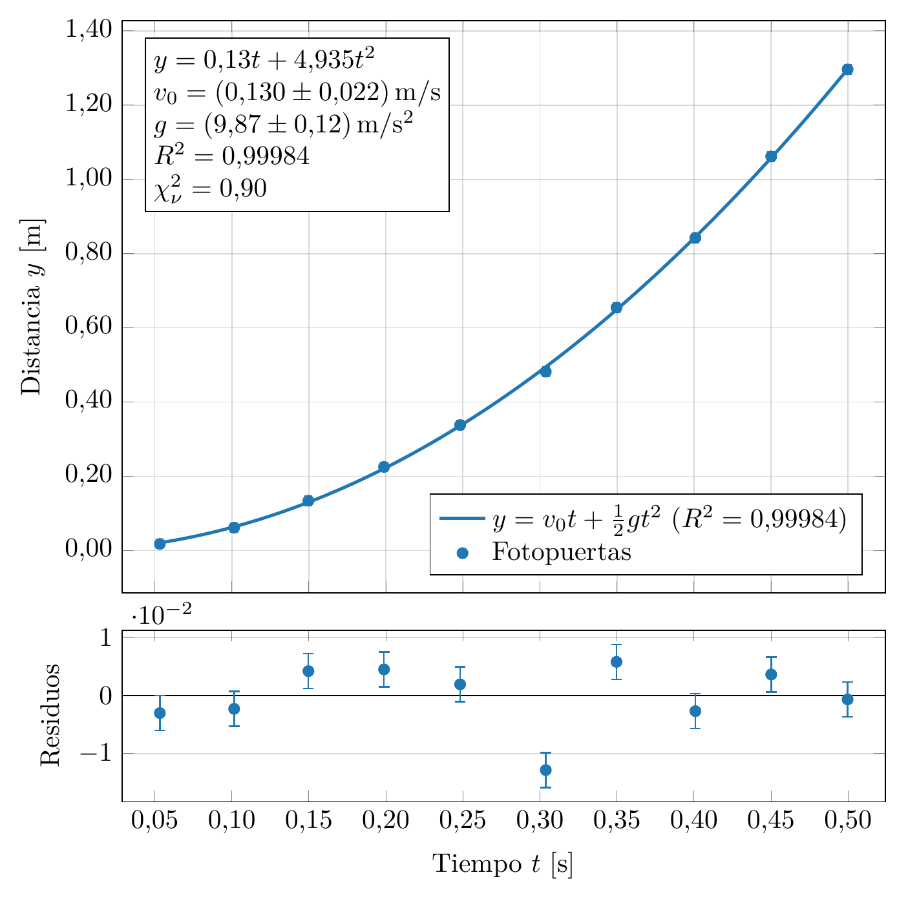

# FisGraf y FisErr

**© 2026 Martín Álvarez de Araya.** Todos los derechos reservados. El uso es **gratuito** y siempre se debe **citar al autor**. Está prohibido venderlo, presentarlo como propio, copiar o modificar su código y usarlo para entrenar IA. Ver [LICENSE](LICENSE).

Análisis de datos de física con calidad de publicación: **gráficos con ajustes y barras de error en LaTeX**, y **propagación de errores** según la GUM. La lógica numérica está escrita en Rust y validada con los datos certificados del NIST. El proyecto tiene tres partes:

| Parte | Carpeta | Para qué |
|---|---|---|
|  **Gráficos: FisGraf** | [`graficos/`](graficos/README.md) | Gráficos desde Excel o CSV:<br>• varias series;<br>• ajustes de modelos (seis métodos) e incertidumbres de los parámetros (cinco métodos);<br>• R² y residuos;<br>• salida en LaTeX/pgfplots (PDF, PNG, SVG, TikZ);<br>• calculadora de errores incluida. |
|  **Errores: FisErr** | [`errores/`](errores/README.md) | Calculadora de errores: ecuación teórica, mediciones con su error y constantes → valor final con su error y la función del error. Tiene cinco métodos: derivadas parciales, segundo orden, Monte Carlo, Kragten y cota máxima. |
| 🤖 **IA** | [`ia/`](ia/README.md) | Las mismas funciones como herramienta para **Claude**, **ChatGPT** (Codex) y **Gemini** (Gemini CLI), mediante línea de comandos y servidor MCP. |

<p align="center"></p>

## ⬇️ Descargas

Todo está en la **[versión 1.0 (Releases)](https://github.com/malvarezdam/FisGraf-FisErr/releases/latest)**. Son programas para Windows 10 u 11 que no necesitan instalación: descomprimes y haces doble clic.

| Parte | Archivo | Qué es |
|---|---|---|
| **Gráficos** | **[Graficos_FisGraf-portable.zip](https://github.com/malvarezdam/FisGraf-FisErr/releases/latest/download/Graficos_FisGraf-portable.zip)** | FisGraf con su manual, proyectos de ejemplo y 8 experimentos de prueba. |
| **Errores** | **[Errores_FisErr-portable.zip](https://github.com/malvarezdam/FisGraf-FisErr/releases/latest/download/Errores_FisErr-portable.zip)** | FisErr con su manual. |
| **IA** | **[IA_Claude.zip](https://github.com/malvarezdam/FisGraf-FisErr/releases/latest/download/IA_Claude.zip)** | Skill para Claude Code con la herramienta incluida. |
| | **[IA_ChatGPT-Codex.zip](https://github.com/malvarezdam/FisGraf-FisErr/releases/latest/download/IA_ChatGPT-Codex.zip)** | Herramienta y configuración para Codex (ChatGPT). |
| | **[IA_Gemini.zip](https://github.com/malvarezdam/FisGraf-FisErr/releases/latest/download/IA_Gemini.zip)** | Extensión para Gemini CLI con la herramienta incluida. |
| | **[IA_fisgraf-cli.exe](https://github.com/malvarezdam/FisGraf-FisErr/releases/latest/download/IA_fisgraf-cli.exe)** | La herramienta sola (línea de comandos y servidor MCP), para cualquier otra app. |

- FisGraf necesita [MiKTeX](https://miktex.org) (o TeX Live) solo para la vista LaTeX y para exportar los gráficos. FisErr no lo necesita.
- Si Windows muestra «Windows protegió su PC», pulsa *Más información → Ejecutar de todas formas* (los `.exe` no están firmados).

**📖 Manuales:**
- [Manual_FisGraf.pdf](graficos/Manual_FisGraf.pdf): FisGraf y FisErr.
- [Manual_FisErr.pdf](errores/Manual_FisErr.pdf): solo FisErr.
- [Manual_completo.pdf](manual/Manual_completo.pdf): incluye la parte de IA.
- [MANUAL.md](manual/MANUAL.md): para leer en GitHub.

## 🤖 Para IA

Detalles en [ia/README.md](ia/README.md). En resumen:

| IA | Instalación |
|---|---|
| **Todas** (Claude Desktop, Codex, Gemini CLI) | En PowerShell: `irm https://raw.githubusercontent.com/malvarezdam/FisGraf-FisErr/main/ia/instalar.ps1 \| iex` |
| **Claude Code** | `/plugin marketplace add malvarezdam/FisGraf-FisErr` y luego `/plugin install fisgraf@fisgraf-fiserr` |
| **ChatGPT** | Con Codex: ver [ia/chatgpt](ia/chatgpt/LEEME.md) |
| **Gemini** | Con Gemini CLI: ver [ia/gemini](ia/gemini/LEEME.md) |

Después basta con pedirle a la IA cosas como:
- «calcula el error de g = 4π²L/T² con L = 1,000 ± 0,001 m y T = 2,007 ± 0,005 s»
- «ajusta los datos de medidas.xlsx a una exponencial y dame τ con su error»
- «haz un gráfico con barras de error y R² de este CSV»

## 📝 Cómo citar

Si usas FisGraf o FisErr en un informe, artículo, tesis o presentación, cítalo así:

> Álvarez de Araya, M. (2026). *FisGraf y FisErr* (v1.0) [Software]. https://github.com/malvarezdam/FisGraf-FisErr

Las apps tienen el botón **Ayuda → Acerca de → Copiar cita**.

## 🛠️ Compilar desde el código

Requisitos: [Rust](https://rustup.rs), y [MiKTeX](https://miktex.org) o TeX Live para los gráficos.

```bash
cargo run --release -p fisgraf
```

```bash
cargo run --release -p fiserr
```

```bash
cargo build --release -p fisgraf-cli
```

| Script (doble clic) | Qué hace |
|---|---|
| `graficos\crear_portable.bat` | `dist\Graficos_FisGraf-portable.zip`. |
| `errores\crear_portable.bat` | `dist\Errores_FisErr-portable.zip`. |
| `ia\crear_paquetes.bat` | `dist\IA_*.zip` e `IA_fisgraf-cli.exe`. |
| `crear_distribucion.bat` | Todo lo anterior, con los manuales: los archivos de una Release. |
| `manual\compilar.bat` | Los manuales en PDF. |

| Carpeta | Contenido |
|---|---|
| `graficos/` | FisGraf y la biblioteca con toda la lógica numérica ([arquitectura e historial](graficos/PLAN.md)). |
| `errores/` | FisErr; usa la lógica de `graficos/`. |
| `ia/` | `fisgraf-cli` (comandos JSON y servidor MCP) y las integraciones para Claude, ChatGPT y Gemini. |
| `manual/` | Fuente LaTeX de los manuales y el manual en Markdown. |

```bash
cargo test --workspace
```
