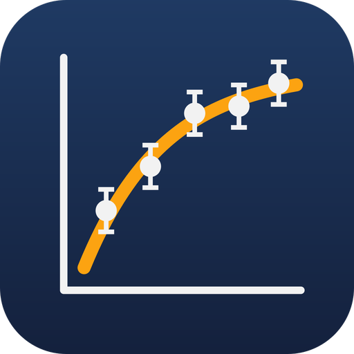
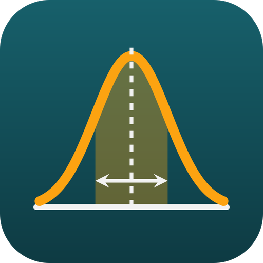

# Análisis de datos de física

Dos aplicaciones de escritorio y una herramienta de línea de comandos que comparten la misma lógica numérica, validada con los datos certificados del NIST:

| | Carpeta | Para qué |
|---|---|---|
|  **FisGraf** | [`graficos/`](graficos/README.md) | Gráficos de datos desde Excel o CSV: ajustes de modelos (seis métodos), incertidumbres (cinco métodos), R², residuos y salida en LaTeX/pgfplots. |
|  **FisErr** | [`errores/`](errores/README.md) | Calculadora de errores: ecuación teórica, mediciones con su error y constantes → valor final con su error y la función del error. |
| **fisgraf-cli** | `graficos/src/bin` | Las mismas funciones por línea de comandos, con entrada y salida JSON. Es la herramienta que usa Claude. |

**📖 Manual de uso:** [MANUAL.pdf](MANUAL.pdf) (para imprimir) o [MANUAL.md](MANUAL.md): cómo usar cada programa y todas sus opciones. Solo FisErr: [MANUAL_FisErr.pdf](MANUAL_FisErr.pdf). Los PDF se regeneran con `manual\compilar.bat`.

**💼 Versión portable:** doble clic en `crear_portable.bat`. Crea la carpeta `portable\` con FisGraf, FisErr, los ejemplos, los manuales y un `LEEME.txt` (sin fisgraf-cli). Se puede copiar a un pendrive o a otro computador con Windows sin instalar nada (FisGraf necesita MiKTeX solo para la vista LaTeX y la exportación).

## Abrir

- **FisGraf:** `graficos\FisGraf.exe` (si no existe, doble clic en `graficos\crear_ejecutable.bat`).
- **FisErr:** `errores\FisErr.exe` (o `errores\crear_ejecutable.bat`).
- **Desde la terminal:**

```bash
cargo run --release -p fisgraf
```

```bash
cargo run --release -p fiserr
```

Requisitos: [Rust](https://rustup.rs) para compilar, y [MiKTeX](https://miktex.org) o TeX Live para los gráficos LaTeX. FisErr no necesita LaTeX.

## Usarlo con Claude

La skill **`fisgraf`** (en `.claude/skills/fisgraf/`, con una copia instalada en `~/.claude/skills/fisgraf/`) le enseña a Claude a usar `fisgraf-cli`. Cuando le pidas, en cualquier conversación, cosas como:

- «calcula el error de g = 4π²L/T² con L = 1,000 ± 0,001 m y T = 2,007 ± 0,005 s»
- «ajusta estos datos a una exponencial y dame τ con su error»
- «haz un gráfico con barras de error y R² de este Excel»

Claude usará esta herramienta en lugar de calcular a mano. Obtendrás los mismos números que en las aplicaciones, redondeados según la GUM, y los gráficos con el mismo estilo LaTeX.

**En otros proyectos:** doble clic en `crear_skill_portable.bat`. Crea `FisGraf-para-Claude.zip`, que contiene la skill con `fisgraf-cli.exe` dentro y 8 ejemplos. Descomprímelo en la raíz de cualquier proyecto (queda `.claude\skills\fisgraf\`) y Claude podrá usar la herramienta ahí. No hay que instalar nada; para los gráficos, ese computador necesita MiKTeX.

## Herramienta de línea de comandos

```bash
fisgraf-cli errores  entrada.json       # propagación de errores
fisgraf-cli ajustar  entrada.json       # ajuste de un modelo a datos (JSON, CSV o Excel)
fisgraf-cli grafico  proyecto.json --formatos pdf,png
fisgraf-cli plantilla errores|ajustar|grafico
```

El formato de cada comando está en [la skill](.claude/skills/fisgraf/SKILL.md) y en su [referencia](.claude/skills/fisgraf/referencia.md).

## Para desarrolladores

```bash
cargo test --workspace
cargo clippy --workspace --all-targets
```
