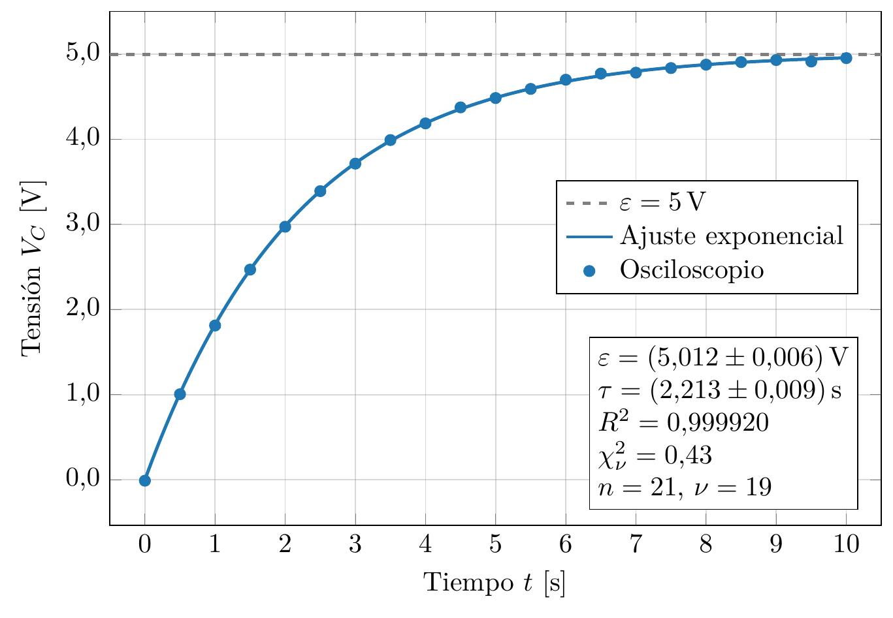
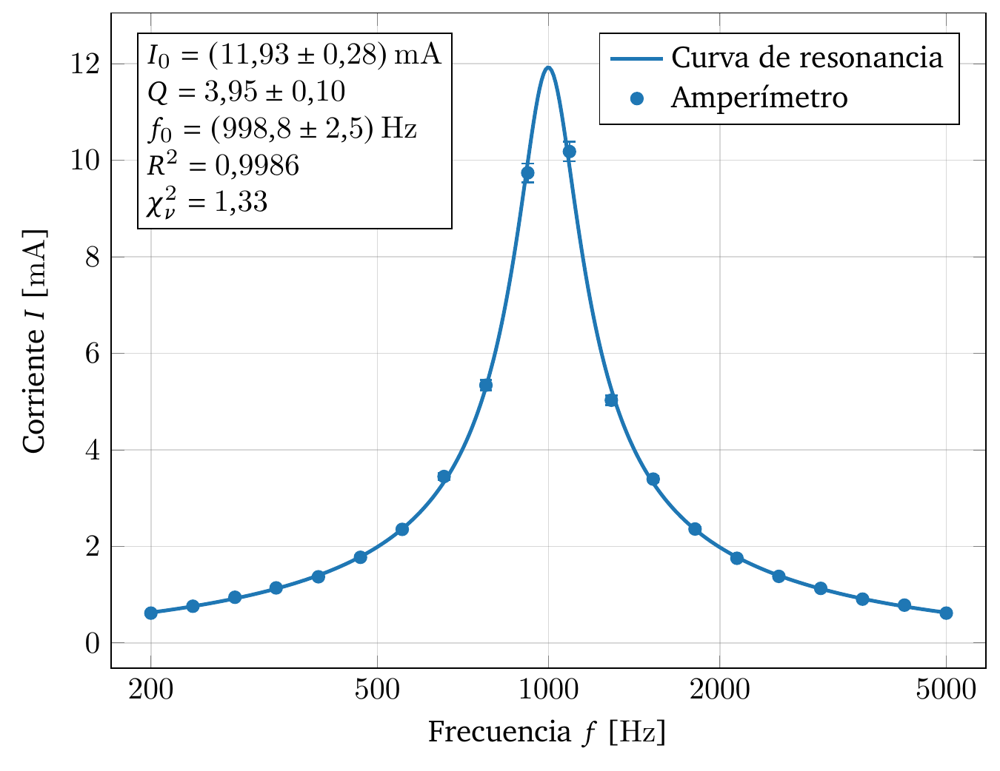
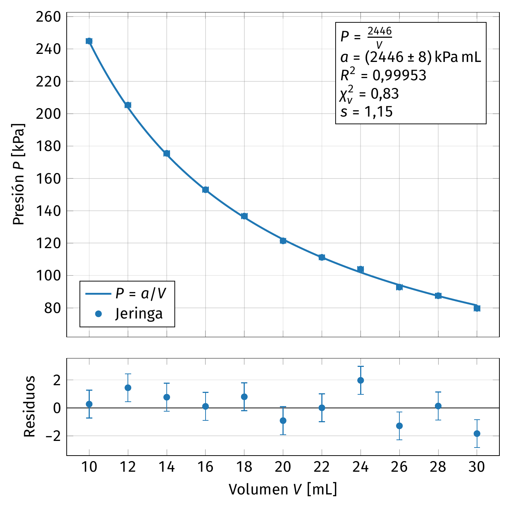

# FisGraf y FisErr

**© 2026 Martín Álvarez de Araya.** Todos los derechos reservados. El uso es **gratuito** y siempre se debe **citar al autor**. Está prohibido venderlo, presentarlo como propio, copiar o modificar su código y usarlo para entrenar IA. Ver [LICENSE](LICENSE).

Análisis de datos de física con calidad de publicación: **gráficos con ajustes y barras de error en LaTeX**, y **propagación de errores** según la GUM. La lógica numérica está escrita en Rust y validada con los datos certificados del NIST.

| Parte | Carpeta | Para qué |
|---|---|---|
|  **FisGraf** | [`graficos/`](graficos/README.md) | Convierte mediciones de un Excel o CSV en un gráfico final: ajusta modelos, calcula el error de cada parámetro y exporta en LaTeX. |
|  **FisErr** | [`errores/`](errores/README.md) | Calculadora de errores: de una ecuación y sus mediciones obtienes el valor final con su error y la función del error. |
| 🤖 **IA** | [`ia/`](ia/README.md) | Las mismas funciones como herramienta para **Claude**, **ChatGPT** (Codex) y **Gemini** (Gemini CLI). |

<p align="center"></p>

**Contenido:** [Descargas](#descargas) · [FisGraf](#fisgraf-gráficos-y-ajustes) · [FisErr](#fiserr-calculadora-de-errores) · [Cómo escribir ecuaciones](#cómo-escribir-ecuaciones) · [Cómo leer los resultados](#cómo-leer-los-resultados) · [Usarlo con una IA](#usarlo-con-una-ia) · [Cómo pedirle las cosas a la IA](#cómo-pedirle-las-cosas-a-la-ia) · [Problemas frecuentes](#problemas-frecuentes) · [Cómo citar](#cómo-citar) · [Compilar](#compilar-desde-el-código)

## Descargas

Todo está en la **[versión 1.0 (Releases)](https://github.com/malvarezdam/FisGraf-FisErr/releases/latest)**. Son programas para Windows 10 u 11 que no necesitan instalación: descomprimes y haces doble clic.

| Parte | Archivo | Qué es |
|---|---|---|
| **Gráficos** | **[Graficos_FisGraf-portable.zip](https://github.com/malvarezdam/FisGraf-FisErr/releases/latest/download/Graficos_FisGraf-portable.zip)** | FisGraf con su manual, proyectos de ejemplo y 8 experimentos de prueba. |
| **Errores** | **[Errores_FisErr-portable.zip](https://github.com/malvarezdam/FisGraf-FisErr/releases/latest/download/Errores_FisErr-portable.zip)** | FisErr con su manual. |
| **IA** | **[IA_Claude.zip](https://github.com/malvarezdam/FisGraf-FisErr/releases/latest/download/IA_Claude.zip)** | Skill para Claude Code con la herramienta incluida. |
| | **[IA_ChatGPT-Codex.zip](https://github.com/malvarezdam/FisGraf-FisErr/releases/latest/download/IA_ChatGPT-Codex.zip)** | Herramienta y configuración para Codex (ChatGPT). |
| | **[IA_Gemini.zip](https://github.com/malvarezdam/FisGraf-FisErr/releases/latest/download/IA_Gemini.zip)** | Extensión para Gemini CLI con la herramienta incluida. |
| | **[IA_fisgraf-cli.exe](https://github.com/malvarezdam/FisGraf-FisErr/releases/latest/download/IA_fisgraf-cli.exe)** | La herramienta sola (línea de comandos y servidor MCP), para cualquier otra app. |

- FisGraf necesita [MiKTeX](https://miktex.org) (o TeX Live) solo para la vista LaTeX y para exportar los gráficos. FisErr no lo necesita.
- Si Windows muestra «Windows protegió su PC», pulsa *Más información → Ejecutar de todas formas* (los `.exe` no están firmados).

**Manuales:** este README es un resumen; cada opción está explicada en los manuales.
- [Manual_FisGraf.pdf](graficos/Manual_FisGraf.pdf): FisGraf y FisErr.
- [Manual_FisErr.pdf](errores/Manual_FisErr.pdf): solo FisErr.
- [Manual_completo.pdf](manual/Manual_completo.pdf): incluye la parte de IA.
- [MANUAL.md](manual/MANUAL.md): para leer en GitHub.

## FisGraf: gráficos y ajustes

| | | |
|---|---|---|
|  |  |  |
| Carga de un condensador | Resonancia RLC, con eje logarítmico | Ley de Boyle, con residuos |

### Primer gráfico en 6 pasos

1. **Datos → Abrir Excel…** y elige tu archivo (`.xlsx`, `.xlsm`, `.xls`, `.xlsb`, `.ods`, `.csv`, `.tsv` o `.txt`).
2. Selecciona las columnas x, y y, si tienes, σy: clic en la primera celda y **Mayús+clic** en la última. Pulsa **Crear serie con la selección**.
3. **Ajustes → + Nuevo ajuste**, escribe la ecuación (por ejemplo, `a*x + b`) y pulsa **Actualizar parámetros**.
4. **Ejes**: escribe los títulos en LaTeX, por ejemplo `Tiempo $t$ [\unit{s}]`.
5. Revisa la **Vista LaTeX** y el panel **Resultados**.
6. **Exportar**: elige los formatos y pulsa **Exportar**.

Guarda con **Ctrl+S**: el proyecto queda en un `.fisgraf.json`, que recuerda la ruta del Excel. Para practicar, usa **Archivo → Abrir ejemplo** o **Abrir datos de prueba**: son 8 experimentos simulados y cada Excel trae una hoja **Notas** con los valores reales.

### Qué hay en cada pestaña

| Pestaña | Qué puedes hacer |
|---|---|
| **Datos** | Abrir el archivo, elegir hoja y seleccionar rangos. Con *Hasta el final de la columna* (`B2:B`), el rango crece si agregas filas. |
| **Series** | Varias series con su color, marcador, leyenda y error. Puntos con o sin barras de error, y unión de puntos. |
| **Ajustes** | Ecuación propia, valores iniciales, parámetros fijos y límites, método de ajuste, método de incertidumbre, banda de confianza y cuadro de resultados en el gráfico. |
| **Referencias** | Curvas teóricas fijas, sin ajuste, para comparar con los datos. |
| **Ejes** | Títulos, límites, escala lineal o logarítmica, marcas, decimales, notación científica y coma decimal. |
| **Estilo** | Tamaño y proporción, fuente, motor LaTeX, cuadrícula, leyenda, cuadro de resultados, panel de residuos y preámbulo propio. |
| **Exportar** | PDF, PNG (300 ppp por defecto), SVG, `.tex` completo o fragmento `tikzpicture` para `\input{}` en tu informe. |
| **Propagación** | La misma calculadora de FisErr, guardada en el proyecto. Sirve, por ejemplo, para obtener una magnitud a partir de la pendiente de un ajuste. |

Hay dos vistas: la **rápida** es instantánea y aproximada, y la **LaTeX** muestra el gráfico final. El panel **Resultados** entrega cada parámetro con su error, χ², χ²_red, p-valor, R², AIC/BIC y correlaciones, con botones para copiar la tabla en LaTeX.

### Cómo indicar el error de las mediciones

| Tipo | Significado |
|---|---|
| Sin error | No se dibujan barras. |
| Columna del Excel | Un error por medición. |
| Constante | El mismo σ para todas. |
| Porcentaje | σ = un % del valor medido. |
| Resolución del instrumento | σ = resolución / (2√3), según la GUM. |

### Qué método elegir

| Método de ajuste | Úsalo cuando… |
|---|---|
| **Automático** | No sabes cuál: decide según el modelo y los errores. |
| Mínimos cuadrados lineales | El modelo es lineal en los parámetros (rectas, polinomios). |
| Levenberg–Marquardt | Es el caso general no lineal. |
| Gauss–Newton | Es no lineal y los valores iniciales son buenos. |
| Nelder–Mead + LM | Los valores iniciales están lejos de la solución. |
| Varianza efectiva / ODR | Hay errores en x y en y; ODR es el tratamiento más riguroso. |

| Incertidumbre de parámetros | Úsala cuando… |
|---|---|
| **Matriz de covarianza** | Casi siempre. *Absoluta* si tus σ son confiables; *escalada por χ²_red* si no lo son. |
| Bootstrap | No quieres suponer errores normales. |
| Monte Carlo | Quieres propagar los σ de tus datos. |
| Jackknife | Quieres ver cuánto depende el resultado de cada punto. |
| Perfil de χ² | El modelo es muy no lineal: da errores asimétricos −σ/+σ. |

## FisErr: calculadora de errores

Escribes la ecuación, indicas qué nombres son mediciones con error y cuáles son constantes, y obtienes el resultado. No necesita LaTeX.

1. **Magnitud:** nombre (`g`), símbolo LaTeX opcional y unidad (`m/s^2`).
2. **Ecuación:** por ejemplo, `4*pi^2*L/T^2`. Pulsa **Detectar variables**.
3. **Tabla:** para cada nombre, elige *Variable medida* o *Constante* y escribe su valor y σ. La distribución (normal, uniforme o triangular) solo la usa Monte Carlo.
4. **Correlaciones** (opcional): solo si dos mediciones no son independientes, por ejemplo si comparten instrumento.
5. **Método y nivel de confianza** (95 % por defecto).

**Ejemplo:** con L = 1,000 ± 0,001 m y T = 2,007 ± 0,005 s, el resultado es **g = 9,80 ± 0,05 m/s²**, con un error relativo de 0,51 %. T aporta cerca del 96 % de la varianza: para mejorar la medición, conviene medir mejor el periodo.

| FisErr entrega | Para qué sirve |
|---|---|
| **Resultado** redondeado según la GUM | Valor listo para el informe, con error relativo e incertidumbre expandida. |
| **Función del error** σ_f | La fórmula simbólica, no solo el número. |
| **Comparación de métodos** | Si los métodos difieren mucho, f no es lineal en el rango de tus errores: confía en Monte Carlo. |
| **Presupuesto de incertidumbre** | Cuánto aporta cada medición al error final. |
| **Histograma de Monte Carlo** | La distribución simulada, con su intervalo. |
| **Derivadas parciales** | ∂f/∂xᵢ de cada variable. |
| **Botones para copiar** | Resultado en LaTeX, entorno `align*` con la propagación, σ_f sola o texto simple. |

| Método de propagación | Úsalo cuando… |
|---|---|
| **Lineal** (derivadas parciales) | Casi siempre: σ_f = √(Σ (∂f/∂xᵢ)² σᵢ²). |
| Segundo orden | f es muy curva o los errores relativos son grandes. |
| Monte Carlo | Quieres el resultado más fiable sin suponer linealidad. |
| Kragten | Quieres el equivalente numérico del lineal (EURACHEM). |
| Cota máxima | Te piden el «error máximo»; es una cota, no una σ. |

Los cálculos se guardan en un `.fiserr.json`, que puede contener varios. El menú **Ejemplos** trae péndulo, densidad de un cilindro, resistencias en paralelo, energía cinética, ley de Snell y constante de un resorte.

## Cómo escribir ecuaciones

La sintaxis es la misma en FisGraf, FisErr y la IA.

| Elemento | Cómo se escribe |
|---|---|
| Operaciones | `+ - * / ^` (también `**`). La multiplicación puede ir implícita: `2pi`, `2(x+1)`. |
| Funciones | `sin cos tan asin acos atan sinh cosh tanh exp ln log10 sqrt abs` |
| Constantes | `pi`, `e` |
| Logaritmo | ⚠️ **`log` es el logaritmo natural**, igual que `ln`. Para base 10, usa `log10`. |
| Ángulos | ⚠️ **En radianes.** Para grados: `sin(t*pi/180)`. |
| Potencias | `-x^2` es −(x²); `2^3^2` es 2⁹. |
| Nombres | `omega` → ω, `T0` → T₀, `T_teo` → T_teo (se convierten solos a LaTeX). |

Todo texto del gráfico se escribe en **LaTeX**: lo que no va entre `$…$` es texto normal, y las unidades van con siunitx (`[\unit{m/s^2}]`).

## Cómo leer los resultados

| Indicador | Interpretación |
|---|---|
| **χ²_red ≈ 1** | El modelo y los errores son coherentes. |
| **χ²_red ≫ 1** | Errores subestimados, o el modelo no describe los datos. |
| **χ²_red ≪ 1** | Errores sobrestimados. |
| **p-valor** | Probabilidad de un χ² igual o peor si el modelo es correcto; menos de 0,05 es sospechoso. |
| **R²** | Fracción de la variación de y que explica el modelo. Por sí solo no garantiza un buen ajuste. |
| **Residuos** | Deben repartirse al azar alrededor de 0. Si muestran una forma, el modelo no es el adecuado. |
| **\|ρ\| > 0,95** | Dos parámetros casi no se pueden separar con estos datos. |

**Redondeo (GUM):** la incertidumbre se da con 1 o 2 cifras significativas (regla del PDG) y el valor se redondea a la misma posición decimal: `9,793 ± 0,021`, `239 ± 4`.

## Usarlo con una IA

La IA llama a `fisgraf-cli` en vez de calcular por su cuenta, así que obtiene los mismos números que las aplicaciones y los gráficos con el mismo estilo LaTeX. Todo se ejecuta en tu computador. Detalles en [ia/README.md](ia/README.md).

**Instalador para Claude Desktop, Codex y Gemini CLI**, en PowerShell:

```powershell
irm https://raw.githubusercontent.com/malvarezdam/FisGraf-FisErr/main/ia/instalar.ps1 | iex
```

Registra la herramienta en las apps que encuentre, guarda antes una copia `.bak` de cada configuración, y luego debes reiniciar la app.

**Plugin para Claude Code**, escribiendo en Claude Code:

```text
/plugin marketplace add malvarezdam/FisGraf-FisErr
/plugin install fisgraf@fisgraf-fiserr
```

| Dónde | Cómo |
|---|---|
| **Un solo proyecto de Claude Code** | Descomprime `IA_Claude.zip` en la raíz del proyecto. |
| **ChatGPT** | Con **Codex**: ver [ia/chatgpt](ia/chatgpt/LEEME.md). |
| **Gemini** | Con **Gemini CLI**: ver [ia/gemini](ia/gemini/LEEME.md). |
| **Cursor, VS Code y otras** | Servidor MCP: `IA_fisgraf-cli.exe` con el argumento `mcp`. |

> Los chats web de ChatGPT y de Gemini no pueden ejecutar programas en tu computador. Por eso se usan Codex y Gemini CLI.

| La IA puede | Herramienta MCP | Comando |
|---|---|---|
| Propagar errores | `propagar_errores` | `fisgraf-cli errores entrada.json` |
| Ajustar un modelo | `ajustar_modelo` | `fisgraf-cli ajustar entrada.json` |
| Generar un gráfico (necesita LaTeX) | `generar_grafico` | `fisgraf-cli grafico proyecto.fisgraf.json` |
| Ver un JSON de ejemplo | `plantilla` | `fisgraf-cli plantilla errores` (o `ajustar`, `grafico`) |
| Consultar el formato de un proyecto | `referencia_proyecto` | [`referencia.md`](ia/claude/skills/fisgraf/referencia.md) |

## Cómo pedirle las cosas a la IA

La skill ya le explica a la IA cómo usar la herramienta, así que no necesitas escribir JSON ni comandos. Lo que la IA no puede adivinar son **los datos y las decisiones físicas de tu experimento**, y de eso depende que el resultado sea correcto.

Normalmente la IA reconoce sola estas tareas. Si no lo hace, agrega **«usa FisGraf»** al pedido.

### Lo que conviene incluir siempre

| Detalle | Cómo decirlo | Si lo omites |
|---|---|---|
| **Qué significa cada ±** | «σ estándar», «resolución de 1 mm» o «U expandida con k = 2». | La herramienta trabaja con la incertidumbre **estándar**. Si un ± es otra cosa y no lo aclaras, el error final queda mal. |
| **Mediciones y constantes** | «L y T son medidas; g₀ = 9,81 es exacta». | Una constante tratada como medición, o al revés, cambia el error final. |
| **Dónde están los datos** | Ruta del archivo, hoja, columnas y primera fila: «hoja Mediciones, x en A, y en B, σy en C, desde la fila 2». | La IA tiene que suponer qué columna es cuál. |
| **Unidades** | Las de cada magnitud y las que quieres en el resultado. | Pueden mezclarse, por ejemplo cm con m. |
| **Ecuación exacta** | La fórmula, sin ambigüedad: «ln es natural, θ en grados». | Recuerda que `log` es natural y que los ángulos van en radianes. |
| **Correlaciones** | «L₁ y L₂ se midieron con la misma regla, ρ = 0,8». | Se suponen independientes. |
| **Decimales** | «Con punto decimal», si lo prefieres. | Se usa coma decimal. |

### Detalles importantes para ajustes

- **Di si confías en tus σ.** Si son confiables, pide **«covarianza absoluta»**. La herramienta usa por defecto la covarianza *escalada por χ²_red*, y la diferencia puede cambiar el error de los parámetros.
- **Nombra la variable independiente** y los parámetros: «ajusta `A*exp(-t/tau) + B`, con variable t».
- **En modelos no lineales, da valores iniciales** del orden correcto: «τ cerca de 5 s». Si no converge, pide `nelder_mead`.
- **Indica límites y parámetros fijos:** «B fijo en 0», «τ positivo».
- **Si hay error en x**, dilo y da su columna; puedes pedir **ODR**.
- **Pide el diagnóstico:** χ²_red, R², residuos y correlación entre parámetros.

### Detalles importantes para gráficos

- **Títulos de ejes con unidades:** «eje x: Tiempo t en s». Si quieres control total, escríbelos en LaTeX: `Tiempo $t$ [\unit{s}]`.
- **Qué debe aparecer:** barras de error, curva ajustada, R² en la leyenda, cuadro de resultados con la ecuación, panel de residuos, banda de confianza o curva teórica de referencia.
- **Formato y salida:** «PDF y PNG a 300 ppp», «fragmento tikzpicture para mi informe» y la carpeta de destino.
- **Estilo, si importa:** ancho en cm, proporción, fuente, escala logarítmica o posición de la leyenda.
- **Revisión:** pide que **mire la imagen** y compruebe que la leyenda y el cuadro no tapen datos.
- **Para retocarlo a mano:** pide que guarde el `.fisgraf.json` y ábrelo con FisGraf.

### Ejemplos de prompts

**Propagación de errores:**

```text
Usa FisGraf para calcular la densidad ρ = m/(pi*(d/2)^2*h).
- m = 45,32 ± 0,02 g (σ estándar de la balanza)
- d = 2,00 cm, con un pie de metro de resolución 0,005 cm
- h = 5,10 cm, con el mismo instrumento
Son mediciones independientes. Entrega ρ en g/cm^3, dime qué medición domina
el error y compara los cinco métodos. Dame también la fórmula en LaTeX.
```

**Ajuste desde un Excel:**

```text
Con FisGraf, ajusta los datos de C:\lab\descarga.xlsx, hoja Mediciones:
t en la columna A, V en B y σV en C, desde la fila 2.
Modelo: V = A*exp(-t/tau) + B, con t como variable. Valores iniciales: A = 5,
tau = 10 y B = 0; tau debe ser positivo.
Los σV son confiables: usa covarianza absoluta. Dame A, tau y B con su error,
χ²_red, R² y la correlación entre parámetros, y dime si el modelo es adecuado.
```

**Gráfico para un informe:**

```text
Con FisGraf, haz un gráfico de los datos de ohm.csv (I en A, V en B, σV en C,
desde la fila 2), con barras de error y el ajuste V = R*I.
- Eje x: Corriente $I$ [\unit{A}]. Eje y: Voltaje $V$ [\unit{V}]
- Cuadro de resultados con la ecuación y R², y panel de residuos
- Coma decimal, ancho 12 cm, PDF y PNG a 300 ppp
Comprueba en la imagen que el cuadro no tape los datos, y deja también el
.fisgraf.json para retocarlo con la app.
```

### Antes de usar la respuesta

- Comprueba que los valores y σ que usó la IA sean los tuyos.
- Mira χ²_red y los residuos, no solo R².
- Si el resultado va en un informe, [cita la herramienta](#cómo-citar).

## Problemas frecuentes

| Problema | Solución |
|---|---|
| «no se encontró lualatex» | Instala MiKTeX y reinicia el programa. |
| La primera compilación tarda o se queda esperando | MiKTeX está instalando paquetes. En *MiKTeX Console → Settings*, elige «Always install missing packages». |
| «error de LaTeX en la línea N» | Revisa los textos del gráfico: escribe `\%` en vez de `%`, y `\_` para un guion bajo fuera de `$…$`. |
| «la celda Hoja1!B7 contiene «abc», que no es un número» | El rango incluye un encabezado o texto: empieza una fila más abajo. |
| El ajuste no converge | Acerca los valores iniciales, prueba Nelder–Mead + LM o pon límites a los parámetros. |
| La leyenda o el cuadro tapan los datos | Cambia su posición en *Estilo*. |
| «Parámetros en la ecuación: …» | Pulsa **Actualizar parámetros**, o **Detectar variables** en FisErr. |
| El Excel cambió y no se ve | **Datos → Recargar**. |

## Cómo citar

Si usas FisGraf o FisErr en un informe, artículo, tesis o presentación, cítalo así:

> Álvarez de Araya, M. (2026). *FisGraf y FisErr* (v1.0) [Software]. https://github.com/malvarezdam/FisGraf-FisErr

Las apps tienen el botón **Ayuda → Acerca de → Copiar cita**.

## Compilar desde el código

Requisitos: [Rust](https://rustup.rs), y [MiKTeX](https://miktex.org) o TeX Live para los gráficos.

```bash
cargo run --release -p fisgraf
```

```bash
cargo run --release -p fiserr
```

```bash
cargo build --release -p fisgraf-cli
```

```bash
cargo test --workspace
```

| Script (doble clic) | Qué hace |
|---|---|
| `graficos\crear_portable.bat` | `dist\Graficos_FisGraf-portable.zip`. |
| `errores\crear_portable.bat` | `dist\Errores_FisErr-portable.zip`. |
| `ia\crear_paquetes.bat` | `dist\IA_*.zip` e `IA_fisgraf-cli.exe`. |
| `crear_distribucion.bat` | Todo lo anterior, con los manuales: los archivos de una Release. |
| `manual\compilar.bat` | Los manuales en PDF. |

| Carpeta | Contenido |
|---|---|
| `graficos/` | FisGraf y la biblioteca con toda la lógica numérica ([arquitectura e historial](graficos/PLAN.md)). |
| `errores/` | FisErr; usa la lógica de `graficos/`. |
| `ia/` | `fisgraf-cli` (comandos JSON y servidor MCP) y las integraciones para Claude, ChatGPT y Gemini. |
| `manual/` | Fuente LaTeX de los manuales y el manual en Markdown. |
