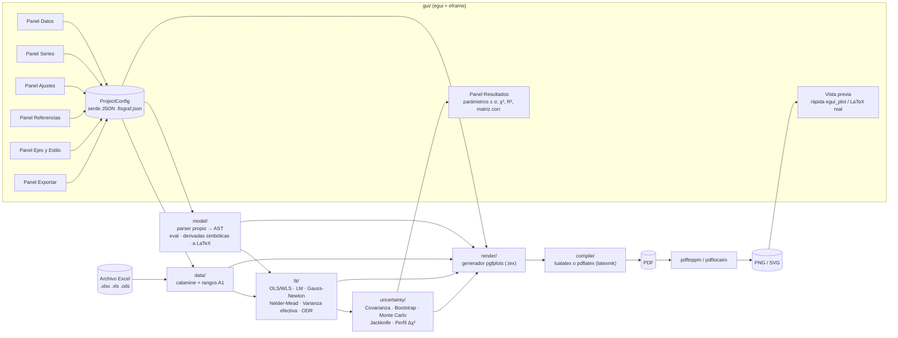

# FisGraf — Plan del proyecto

Programa de escritorio en **Rust + egui** que lee datos desde Excel, ajusta modelos
teóricos con varios métodos numéricos, calcula las incertidumbres de los parámetros y
genera gráficos de calidad de publicación con **LaTeX (pgfplots)**.

---

## 1. Entorno verificado (27-10-2026)

| Herramienta | Estado |
|---|---|
| Rust / Cargo | 1.97.1 ✅ |
| MiKTeX 25.12 (`pdflatex`, `lualatex`, `xelatex`, `latexmk`) | ✅ |
| Paquetes `pgfplots`, `siunitx`, `fontspec`, `lmodern`, `newtxmath`, `standalone` | ✅ |
| `pdftoppm` / `pdftocairo` (incluidos en MiKTeX; PDF → PNG/SVG) | ✅ |
| Git | 2.55 ✅ |

---

## 2. Arquitectura



### Estructura de carpetas

```
fisgraf/
├─ Cargo.toml
├─ src/
│  ├─ main.rs                 # arranque eframe
│  ├─ config/                 # ProjectConfig, SeriesConfig, AxisConfig… (serde)
│  ├─ data/
│  │  ├─ excel.rs             # calamine: hojas, celdas, lectura de rangos
│  │  └─ range.rs             # "Hoja1!B2:B20" ↔ coordenadas
│  ├─ model/
│  │  ├─ parser.rs            # texto → AST (x, parámetros, constantes, funciones)
│  │  ├─ eval.rs              # evaluación numérica
│  │  ├─ diff.rs              # derivadas simbólicas ∂f/∂p, ∂f/∂x
│  │  └─ latex.rs             # AST → LaTeX (\sqrt{}, \frac{}{}, subíndices)
│  ├─ fit/
│  │  ├─ linear.rs            # OLS / WLS por QR-SVD (modelos lineales en parámetros)
│  │  ├─ lm.rs                # Levenberg–Marquardt (variante de Moré, escalado)
│  │  ├─ gauss_newton.rs      # con búsqueda lineal
│  │  ├─ nelder_mead.rs       # sin derivadas, para semillas malas
│  │  ├─ effective_var.rs     # varianza efectiva (errores en x e y)
│  │  └─ odr.rs               # regresión de distancia ortogonal (estilo ODRPACK)
│  ├─ uncertainty/
│  │  ├─ covariance.rs        # (JᵀWJ)⁻¹, σ absoluta o escalada por χ²_red
│  │  ├─ bootstrap.rs         # residuos y pares, intervalos percentil
│  │  ├─ monte_carlo.rs       # propagación de σx, σy
│  │  ├─ jackknife.rs
│  │  ├─ profile.rs           # perfil Δχ² = 1 (errores asimétricos)
│  │  └─ stats.rs             # χ², χ²_red, p-valor, R², AIC/BIC, bandas de confianza
│  ├─ render/
│  │  ├─ pgfplots.rs          # genera el .tex
│  │  ├─ format.rs            # formato numérico, redondeo de incertidumbres
│  │  ├─ compile.rs           # llama al motor LaTeX, interpreta el .log
│  │  └─ convert.rs           # pdftoppm / pdftocairo
│  └─ gui/
│     ├─ app.rs               # estado, guardado/carga, deshacer
│     ├─ panels/              # datos, series, ajustes, referencias, ejes, estilo, exportar
│     ├─ preview.rs           # vista rápida + vista LaTeX (hilo en segundo plano)
│     └─ results.rs
├─ tests/                     # incluye validación NIST StRD
└─ examples/                  # Excel y proyectos de ejemplo (péndulo, Hooke, decaimiento)
```

---

## 3. Decisiones técnicas

### 3.1 Ecuaciones
- El modelo se escribe con **sintaxis calculable**: `2*pi*sqrt((L + a)/g)`.
  En el formulario se indica cuál es la **variable medida** (p. ej. `L`) y cuáles son los
  **parámetros por ajustar** (p. ej. `a`, `g`), cada uno con su valor inicial y límites opcionales.
- El programa **convierte automáticamente** la expresión a LaTeX (`2\pi\sqrt{\frac{L+a}{g}}`)
  y también deja editar la etiqueta LaTeX a mano.
- Se usa un **parser propio** (AST) en lugar de una librería, porque así controlamos la evaluación,
  las derivadas simbólicas (Jacobiano exacto, sin diferencias finitas) y la conversión a LaTeX.
- Funciones: `sin cos tan asin acos atan sinh cosh tanh exp ln log10 sqrt abs pow`; constantes `pi`, `e`.
- Si el modelo es lineal en los parámetros (se detecta en el AST), se ofrece el ajuste lineal exacto.

### 3.2 Métodos de ajuste (seleccionables por ajuste)
| Método | Cuándo usarlo |
|---|---|
| **Mínimos cuadrados lineales (OLS/WLS)** vía QR/SVD | Modelos lineales en los parámetros (rectas, polinomios). Solución exacta. |
| **Levenberg–Marquardt** *(por defecto)* | Estándar para modelos no lineales (igual que `scipy.curve_fit`, MINPACK, gnuplot `fit`). |
| **Gauss–Newton con búsqueda lineal** | Problemas bien condicionados con buena semilla. |
| **Nelder–Mead** | Sin derivadas. Sirve con semillas malas; luego se refina con LM. |
| **Varianza efectiva** | Hay errores en x y en y: σ²_ef = σy² + (∂f/∂x · σx)², iterativo. Muy usado en laboratorios de física. |
| **ODR (distancia ortogonal)** | Hay errores en x e y comparables. Es el tratamiento riguroso (ODRPACK / `scipy.odr`). |

Todos admiten **pesos 1/σ²** cuando hay columnas de error. Las barras de error se pueden dar como columna, constante, porcentaje o resolución del instrumento.

### 3.3 Métodos de incertidumbre (seleccionables)
| Método | Notas |
|---|---|
| **Matriz de covarianza** *(por defecto)* | (JᵀWJ)⁻¹. Hay dos modos: σ absoluta (cuando los errores son conocidos) o escalada por χ²_red. Es la misma opción que `absolute_sigma` en SciPy. |
| **Bootstrap** (residuos / pares) | N configurable, intervalo percentil. Robusto y no supone normalidad. |
| **Monte Carlo** | Re-muestrea los datos según σx y σy y vuelve a ajustar. |
| **Jackknife** | Deja fuera un punto cada vez. |
| **Perfil de χ² (Δχ² = 1)** | Errores **asimétricos** en modelos fuertemente no lineales. |

Salida: valor ± σ, intervalo de confianza con *t* de Student, matriz de correlación, χ², χ²_red, p-valor, R², AIC/BIC y residuos. Además, **redondeo según la GUM** (1–2 cifras significativas en la incertidumbre) y banda de confianza opcional en el gráfico.

**Validación:** los ajustadores se prueban contra los conjuntos certificados **NIST StRD** (Misra1a, Thurber, MGH09, etc.).

### 3.4 Gráfico LaTeX (pgfplots)
- Documento `standalone`. Motor **lualatex** por defecto (permite cualquier fuente del sistema mediante `fontspec`), con `pdflatex` como alternativa.
- Las tendencias y las funciones de referencia se **muestrean en Rust** y se escriben como tablas. Así se evitan los problemas de precisión de `pgfmath` y lo dibujado coincide exactamente con el cálculo.
- Opciones: título, etiquetas de ejes en LaTeX, cuadrícula mayor/menor, mínimos y máximos manuales, escala log, ticks (distancia, número de menores, lista manual), formato numérico de ejes (fijo/científico, decimales, coma decimal), proporción (4:3, 16:9, 9:16, 1:1, personalizada) y ancho en cm. También: fuente (Latin Modern, Times/newtx, Palatino/newpx, Libertine, Charter, Fira Sans, o cualquiera del sistema), posición de la leyenda (las 4 esquinas, fuera, o coordenadas), colores, marcadores, estilos de línea, barras de error en x/y, banda de incertidumbre, **subgráfico de residuos** opcional y cuadro con los parámetros ajustados.
- Exportación: **PDF**, **PNG** (DPI elegible), **SVG**, `.tex` standalone y **fragmento `tikzpicture`** para pegar con `\input{}` en un informe.

### 3.5 Interfaz (egui)
- Panel izquierdo con pestañas: **Datos · Series · Ajustes · Referencias · Ejes · Estilo · Exportar**.
- Centro: vista previa con dos modos. La **rápida** (egui_plot) es instantánea; la **LaTeX real** se compila en segundo plano y se muestra como imagen.
- Panel inferior: resultados de los ajustes (copiables en LaTeX) y registro de errores de compilación.
- Proyectos guardables como `.fisgraf.json` (ruta del Excel relativa), además de deshacer/rehacer.

### 3.6 Crates principales
`eframe`/`egui`, `egui_plot`, `egui_extras`, `rfd` (diálogos de archivo), `calamine` (Excel), `nalgebra` (álgebra lineal), `rand` + `rand_distr`, `statrs` (distribuciones t y χ²), `serde` + `serde_json`, `anyhow`/`thiserror`, `image`. Las versiones exactas se fijan con `cargo add` en la Fase 0.

---

## 4. Fases de ejecución y estimación de tokens

Cada fase está pensada para hacerse **en una sola sesión**. Termina con el proyecto compilando, los tests pasando y un **commit de git**, así nunca queda a medias. Si una sesión se corta, la siguiente retoma desde el último commit y la casilla marcada abajo.

> **Sobre los tokens:** no puedo ver tu cuota restante. La columna "salida" es el código y el texto que escribo. La columna "uso total" incluye además leer contexto, compilar y corregir errores (la mayor parte es contexto en caché). Son estimaciones de orden de magnitud: compara el uso total de cada fase con lo que te quede antes de pedirla.

| Fase | Contenido | ~Líneas | ~Salida | ~Uso total |
|---|---|---:|---:|---:|
| 0 | Esqueleto, dependencias, structs de configuración, git | 300 | 8 k | 40–60 k |
| 1 | Lectura de Excel, rangos A1, columnas de error, tests | 600 | 12 k | 70–100 k |
| 2 | Parser de ecuaciones, evaluación, derivadas, → LaTeX | 900 | 18 k | 90–130 k |
| 3 | Ajustadores (OLS/WLS, LM, GN, NM, Var. efectiva, ODR) + NIST | 1200 | 25 k | 130–180 k |
| 4 | Incertidumbres y estadísticos, redondeo GUM, bandas | 900 | 18 k | 110–150 k |
| 5 | Generador pgfplots, compilación, conversión PNG/SVG | 1100 | 22 k | 130–180 k |
| 6 | GUI I: app, proyectos, paneles Datos/Series, vista rápida | 1300 | 26 k | 150–200 k |
| 7 | GUI II: paneles Ajustes/Referencias/Ejes/Estilo/Exportar, Resultados | 1400 | 28 k | 150–220 k |
| 8 | Vista previa LaTeX en vivo, ejemplos, manual, pulido | 700 | 14 k | 100–150 k |
| **Total** | | **~8 400** | **~170 k** | **~1,0–1,4 M** |

Las fases 1, 2 y 5 no dependen entre sí y podrían hacerse en paralelo en sesiones separadas. La 3 necesita la 2; la 4 necesita la 3; las 6–8 necesitan todas las anteriores.

---

## 5. Cómo pedirme cada fase

Copia el mensaje de la fase en un chat nuevo abierto **en esta carpeta**. `CLAUDE.md` hace que lea este plan automáticamente.

**Fase 0**
> Ejecuta la Fase 0 del PLAN.md: crea el proyecto Cargo `fisgraf`, añade las dependencias, la estructura de módulos y los structs de configuración con serde, inicializa git y haz el primer commit.

**Fase 1**
> Ejecuta la Fase 1 del PLAN.md: módulo `data` (lectura de Excel con calamine, rangos tipo `Hoja1!B2:B20`, listado de hojas, columnas de error como columna/constante/porcentaje) con tests y un Excel de ejemplo.

**Fase 2**
> Ejecuta la Fase 2 del PLAN.md: módulo `model` (parser propio a AST, evaluación, derivadas simbólicas, detección de linealidad, conversión a LaTeX) con tests.

**Fase 3**
> Ejecuta la Fase 3 del PLAN.md: módulo `fit` con OLS/WLS, Levenberg–Marquardt, Gauss–Newton, Nelder–Mead, varianza efectiva y ODR, validado con NIST StRD.

**Fase 4**
> Ejecuta la Fase 4 del PLAN.md: módulo `uncertainty` (covarianza absoluta/escalada, bootstrap, Monte Carlo, jackknife, perfil Δχ², estadísticos, bandas de confianza y redondeo GUM) con tests.

**Fase 5**
> Ejecuta la Fase 5 del PLAN.md: módulo `render` (generación pgfplots con todas las opciones de estilo, compilación con lualatex/pdflatex, lectura de errores del log, exportación PDF/PNG/SVG/.tex/fragmento) y genera un gráfico de ejemplo como el del péndulo.

**Fase 6**
> Ejecuta la Fase 6 del PLAN.md: GUI parte I (app eframe, guardar/cargar proyecto, deshacer, paneles Datos y Series, vista previa rápida con egui_plot).

**Fase 7**
> Ejecuta la Fase 7 del PLAN.md: GUI parte II (paneles Ajustes, Referencias, Ejes, Estilo, Exportar y Resultados).

**Fase 8**
> Ejecuta la Fase 8 del PLAN.md: vista previa LaTeX en vivo en segundo plano, proyectos de ejemplo, manual de uso en README y pulido final.

**Si una fase quedó interrumpida**
> Continúa la fase que quedó a medias según PLAN.md y el último commit.

---

## 6. Progreso

- [x] Fase 0 — Esqueleto
  - El proyecto Cargo está en la raíz de esta carpeta (no en una subcarpeta `fisgraf/`): `src/lib.rs` contiene los módulos y `src/main.rs` abre la ventana.
  - Versiones fijadas: eframe/egui 0.37, egui_plot 0.38, calamine 0.37, nalgebra 0.35, rand 0.10, rand_distr 0.6, statrs 0.19, rfd 0.17.
  - En eframe 0.37 el método requerido del `App` es `fn ui(&mut self, ui: &mut egui::Ui, frame)`, no `update`.
  - La configuración está en `src/config/` (mod, style, series, fit, reference, axis, figure, export). Los ajustes apuntan a las series por `id`; un ajuste puede aplicarse a varias series (`series_ids`), una curva por cada serie.
- [x] Fase 1 — Datos (Excel)
  - `data::Workbook` carga el libro entero en memoria y ofrece `sheet_names`, `preview` (para la tabla de la GUI), `read_vector` y `nth_cell_name`.
  - `data::load_series` devuelve `SeriesData { x, y, x_err, y_err, skipped }`. Las filas sin x o sin y se descartan y quedan anotadas en `skipped`.
  - Rangos admitidos: `B2:B20`, `Hoja1!B2:B20`, `'Mi hoja'!$B$2:$B$20`, filas `C3:H3` y rangos abiertos `B2:B` (hasta la última celda con datos). Si no se indica hoja, se usa la primera.
  - Los números guardados como texto aceptan coma decimal y separador de miles. Un único `1,000` se lee como 1,0 (convención en español).
  - Los mensajes de error indican la serie y la celda, p. ej. `serie «X»: la celda Datos!A11 contiene «texto», que no es un número`.
  - Excel de ejemplo en `examples/datos/ejemplo.xlsx` (hojas Pendulo, Imanes, Hooke). Se regenera con `cargo run --example generar_excel_ejemplo` y los tests dependen de él.
- [x] Fase 2 — Ecuaciones
  - `model::Model::new(expr, variable, &params, &constants)` valida la ecuación y ofrece `eval`, `gradient` (∂f/∂pₖ exactas), `dfdx`, `is_linear` y `to_latex`. Rechaza nombres sin definir, parámetros que no aparecen, nombres repetidos o reservados.
  - Sintaxis: `+ - * / ^` (`**` también), multiplicación implícita (`2pi`, `2(x+1)`, `a(x-b)`), `pi`, `e` y funciones `sin cos tan asin acos atan sinh cosh tanh exp ln log10 sqrt abs sign pow(a,b)`, con alias `sen`, `arcsin`, `sgn`. **`log` es el logaritmo natural**, como en C y Python; el decimal es `log10`. `-x^2` = −(x²). La potencia asocia a la derecha. `1/2x` = x/2.
  - Las derivadas se simplifican al construirse (`simplify.rs`). Las potencias enteras usan `powi`, que es exacta y admite bases negativas.
  - LaTeX: `\frac`, `\sqrt`, `\sin^{2}(…)`, `e^{…}` (`\exp(…)` si el exponente es largo) y signo delante de la fracción. Los nombres se convierten así: `omega`→`\omega`, `ω`→`\omega`, `T_teo`→`T_{\mathrm{teo}}`, `x0`→`x_{0}`; los nombres de varias letras van en `\mathrm`. Admite coma decimal (`0{,}987`) y símbolos definidos por el usuario (`LatexOptions::symbols`, que corresponde a `ParameterConfig.latex`).
  - `model::suggest_parameters` propone como parámetros los nombres que no son la variable ni constantes, para usarlo en la GUI.
- [x] Fase 3 — Ajustadores
  - API: `fit::fit(&model, &FitData, &FitOptions) -> FitResult`. `FitOptions::from_config(&FitConfig)` y `fit::build_model(&ModelConfig)` enlazan con la configuración. `FitData::from(&SeriesData)`.
  - `FitResult` incluye: `params` (con los fijos), `free`, `chi2`, `dof`, `weighted`, `converged`, `iterations`, `residuals` (y − f), `sigma` (σ usada por punto), `x_shift` (δ de ODR), `jacobian` (ponderado, n × libres, para la covarianza de la Fase 4) y `warnings` en español.
  - Elección de `Auto`: varianza efectiva si hay σx; lineal si el modelo es lineal y no tiene límites; si no, LM. EV y ODR sin σx pasan a WLS con un aviso.
  - Parámetros fijos y límites: los límites se aplican proyectando el paso. El método lineal los ignora y lo avisa.
  - Nelder–Mead se refina siempre con LM al final, para que el jacobiano y la convergencia sean fiables.
  - ODR: LM sobre (β, δ) con complemento de Schur, O(n·m²). Su `jacobian` usa la σ efectiva en los x corregidos, que es la covarianza estándar de ODRPACK.
  - **Validación NIST StRD** (`tests/nist/*.dat`, `tests/nist.rs`):
    - LM desde el punto de partida 2: los 20 problemas no lineales con 6,4 a 12,7 cifras correctas, incluidos los de dificultad alta.
    - Desde el punto de partida 1: LM o NM+LM resuelven 18 de 20. Fallan MGH10 (con ambos métodos) y Rat43 con NM+LM.
    - Mínimos cuadrados lineales: Norris, Pontius y Wampler1–5 con 6,5 a 13 cifras.
    - Gauss–Newton: los problemas fáciles con 8,6 a 11 cifras.
  - Lección: con escalado de Marquardt (λ·diag JᵀJ), λ inicial debe ser adimensional (1e‑3). Además, para declarar convergencia por paso pequeño se exige gradiente ≈ 0, y para declararla por χ² estancado, dos iteraciones seguidas.
- [x] Fase 4 — Incertidumbres
  - API: `uncertainty::estimate(&model, &data, &opts, &fit_result, &UncertaintyConfig) -> UncertaintyResult`. Contiene por parámetro `value`, `sigma`, `minus`, `plus`, `ci_low`, `ci_high` y `fixed`, además de `covariance`, `correlation` (libres × libres), `coverage_factor`, `samples` (bootstrap/MC) y `warnings`.
  - Covarianza: (JᵀWJ)⁻¹ por SVD con columnas normalizadas. En modo **absoluto** usa intervalos con z (solo si hay pesos; sin pesos pasa a escalado con un aviso). En modo **escalado por χ²_red** usa t de Student con ν grados de libertad.
  - Bootstrap de residuos: estandarizados por σᵢ e inflados por √(n/ν). Bootstrap de pares: descarta muestras con menos x distintos que parámetros. Monte Carlo: ruido normal con σx y σy sobre los datos medidos (GUM‑S1). Jackknife: n ajustes, var = (n−1)/n·Σ(θᵢ−θ̄)². Perfil Δχ²: bisección por cada lado, con Δ = escala para 1σ y Δ = k²·escala para el intervalo.
  - Los re-muestreos corren en paralelo con un generador por muestra derivado de (semilla, índice), así el resultado es reproducible sin importar cuántos hilos haya. Se exige que converja al menos el 50 % de las muestras.
  - `confidence_band`: con bootstrap/MC usa percentiles de las curvas; con los demás métodos, propagación lineal ∇fᵀC∇f.
  - `goodness_of_fit`: χ², χ²_red, p-valor (solo con pesos), SSR, s, R², R² ajustado, AIC, AICc y BIC.
  - `rounding::round_gum`: regla del PDG (100–354 → 2 cifras, 355–949 → 1, 950–999 → sube a 1000), o 1 o 2 cifras fijas. Usa notación científica si max(|v|, σ) ≥ 10⁴ o < 10⁻³. Formatos `plain()` y `latex()` con coma decimal.
  - **Validación NIST**: las σ certificadas de 20 problemas no lineales y 4 lineales se reproducen con 7,0 a 13,8 cifras correctas (`tests/nist.rs::certified_standard_deviations`).
- [x] Fase 5 — Render LaTeX
  - **Nuevo módulo `pipeline`** (no estaba en el plan; es la pieza que usará la GUI):
    - `compute(&project, Option<&Workbook>) -> Computed` lee las series, ajusta cada par (ajuste, serie) y estima incertidumbres y estadísticos. Los errores se guardan como `String` por elemento, así un ajuste que falla no tumba el gráfico.
    - `build_scene(&project, &computed) -> Scene` muestrea curvas, bandas, residuos y arma el cuadro de resultados. `Scene.warnings` reúne los avisos en español.
  - `render::generate(&project, &scene) -> TexDocument { full, picture, preamble, warnings }`. `render::export(&project, &scene, dir)` escribe PDF, PNG, SVG, `.tex` y `_tikz.tex` según `ExportConfig`.
  - Decisiones:
    - Los datos se escriben con `coordinates {(x,y) +- (ex,ey)}`, porque las tablas en línea `table[row sep=\\]` fallan dentro de `axis`.
    - `unbounded coords=jump` corta las curvas en valores no finitos.
    - Los estilos de las etiquetas de los ejes terminan en `/tikz/.cd`; si no, la etiqueta del factor ×10ⁿ falla.
    - El rango x siempre es explícito: el manual, o el de los datos más un 5 %. Las referencias usan todo ese rango y los ajustes, el de su serie (o `domain`).
    - La coma decimal global (siunitx, ecuaciones, cuadro de resultados) se toma de `y_axis.number_format.decimal_comma`.
    - Los colores se definen dentro del `tikzpicture` (`fgRRGGBB`), así el fragmento funciona solo.
    - El panel de residuos usa formato automático con factor común.
    - Unidades de los parámetros con `\unit{}` de siunitx.
  - Compilación: `-interaction=nonstopmode -halt-on-error -file-line-error`, sin ventana de consola, con límite de 180 s. El error devuelve la línea del `.tex`, el mensaje y el contexto del `.log`.
  - Guardado: la ruta del Excel se guarda relativa con `..` cuando están en la misma unidad.
  - Ejemplos: `cargo run --example generar_graficos_ejemplo` crea `examples/proyectos/{imanes,pendulo}.fisgraf.json` y exporta a `examples/salida/` (ignorada en git). `imanes` replica el gráfico de referencia; `pendulo` da g = 9,784 ± 0,022 m/s² con banda, cuadro y residuos.
  - Verificado: las 7 fuentes compilan con LuaLaTeX y pdfLaTeX (`cargo test --test render -- --ignored`, unos 2 min).
  - Para la Fase 8: `export::build_dir()` es una carpeta por proceso. La vista previa debe usar un nombre de archivo propio para no pisar una exportación en curso.
- [x] Fase 6 — GUI I
  - `gui::FisGrafApp::draw(ui)` dibuja todo (separado de `eframe::App` para poder probarlo con `egui_kittest`). `fisgraf.exe proyecto.fisgraf.json` abre un proyecto.
  - API de egui 0.37: `egui::Panel::{top,bottom,left}(…).show(ui, …)`, `CentralPanel::default_margins()`, `MenuBar::new().ui`, `ui.close()`, `ui.scope_id()`, `Id::unique`, `egui::Role` (antes `WidgetType`). Los ids piden `Hash + Debug`.
  - **Cálculo en segundo plano** (`gui/worker.rs`): agrupa los cambios (250 ms), corre un cálculo a la vez y descarta resultados viejos. Compara contra el proyecto pendiente, el que está en curso y el último calculado, para no recalcular lo mismo.
  - **Deshacer/rehacer** (`gui/history.rs`) con instantáneas del proyecto. Se confirma cuando no se arrastra ni se escribe. Ctrl+Z/Ctrl+Y, Ctrl+N/O/S/Mayús+S. Mientras se escribe, Ctrl+Z es del campo de texto.
  - **Cambios sin guardar**: el título muestra ●. Nuevo, Abrir y cerrar la ventana piden confirmación (Guardar / No guardar / Cancelar).
  - **Pestaña Datos**: abrir y recargar el Excel; elegir hoja; tabla de celdas (hasta 1000×40) con clic, Mayús+clic y clic en la letra de columna. Botones → x, → y, → σx, → σy; "Crear serie con la selección" (x, y, σy) con nombre tomado del encabezado; opción de rango abierto. Resalta los rangos de la serie elegida. Al abrir un proyecto muestra la hoja de la primera serie.
  - **Pestaña Series**: crear, duplicar, eliminar (también la quita de los ajustes) y reordenar. Editor de leyenda LaTeX con vista en texto, rangos validados (✓/✖), errores en sus 4 formas, color, marcador, topes y unión de puntos. Muestra "N puntos (M filas vacías descartadas)" o el error.
  - **Vista rápida** (egui_plot): curvas con trazos, bandas, barras de error y marcadores; escala log aproximada con log₁₀; las etiquetas LaTeX pasan a texto con `gui::text::latex_to_plain` (griegas, sub/superíndices, `\frac`, `\unit`).
  - Lecciones:
    - egui_plot 0.38 deriva el id de cada elemento de su nombre. Los elementos con el mismo nombre (barras y marcadores de una serie) necesitan `.id(…)` explícito, o no se dibujan.
    - La fuente de egui no trae σ, χ, →, ✔…; se cargan Segoe UI y Segoe UI Symbol (o DejaVu/Arial Unicode) como respaldo (`gui/fonts.rs`). ⬆ y ＋ no existen ni ahí: se usan ↑ y +.
    - kittest exige nombre accesible en los ComboBox: `widgets::accessible`.
    - Los números de la tabla se muestran con 12 cifras significativas (`0.30000000000000004` → `0.3`).
  - Verificado a mano con capturas de pantalla (imanes y péndulo) y con 6 pruebas de kittest (`tests/gui.rs`).
- [x] Fase 7 — GUI II
  - **Ajustes** (`gui/panels/fits.rs`):
    - Crear, duplicar, eliminar y activar ajustes; elegir a qué series se aplican.
    - Ecuación con validación y vista LaTeX en vivo (con botón para copiar el LaTeX). Avisa si el modelo es lineal.
    - "Actualizar parámetros" (`gui::sync_parameters`) agrega los nombres nuevos de la ecuación, quita los que ya no están y conserva la configuración de los que siguen.
    - Tabla de parámetros: inicial, fijo, mín/máx opcionales, símbolo LaTeX y unidad siunitx.
    - Método de ajuste con explicación (`gui/names.rs`) y opciones avanzadas (iteraciones, tolerancia, pesos).
    - Incertidumbre: método, modo de covarianza, tipo de bootstrap, muestras, semilla y nivel de confianza.
    - Curva: estilo (hereda el color de la serie), banda, dominio, puntos y cuadro de resultados.
    - Estado por serie: convergencia, χ²_red y avisos.
  - **Referencias**: ecuación, variable, tabla de constantes con "Agregarlas" para los nombres sin valor, LaTeX propio, dominio y estilo.
  - **Ejes**: título LaTeX, límites opcionales, escala, marcas (automáticas / cada… / en posiciones `1; 2,5; 4`, que lee `gui::parse_tick_list`), marcas menores, dirección y formato numérico completo.
  - **Estilo**: título, ancho, proporción (con tamaño resultante en cm), fuente (incluida una del sistema, que avisa si no se usa LuaLaTeX), tamaño, motor, cuadrícula, leyenda (posición, columnas, marco, opacidad), cuadro de resultados, residuos y preámbulo extra.
  - **Exportar**:
    - Carpeta: la elegida, o la del proyecto si no se eligió.
    - Exporta en otro hilo (`gui::export_project`) y lista los archivos con botón "Abrir".
    - "Copiar código tikzpicture" copia el fragmento sin escribir archivos.
  - **Resultados** (panel inferior, pestañas Resultados / Mensajes con contador):
    - Por ajuste: método, iteraciones y pesos; parámetros con redondeo GUM, σ (o −/+ en el perfil) e IC; χ², ν, χ²_red, p, R², s, AIC/BIC.
    - Correlación con alerta si |ρ| > 0,95.
    - "Copiar tabla LaTeX" (`gui::results::results_latex`) y "Copiar texto".
  - Lección: un panel de egui guarda el tamaño de su contenido. Si el contenido no llena el panel (o si lo fuerza a crecer), el alto queda mal. Lo correcto es envolver todo en un `ScrollArea` con `auto_shrink(false)`.
  - Verificado con capturas de todas las pestañas y con 12 pruebas de kittest (incluida la exportación real a PDF).
- [x] Fase 8 — Vista previa LaTeX y pulido
  - **Vista LaTeX** (`gui/latex_preview.rs`):
    - Selector "Vista rápida / Vista LaTeX" sobre la vista central.
    - Compila solo mientras la vista LaTeX está visible y cuando terminó el cálculo del proyecto actual, una vez a la vez. Si el proyecto cambió durante la compilación, vuelve a compilar al terminar.
    - Usa una carpeta propia (`build_dir()/vista`, archivo `vista_previa`) para no pisar exportaciones. PNG a 200 ppp cargado con `image` como textura.
    - Si hay un error, se ve junto con la última imagen que compiló.
  - **Pedido del usuario durante la fase:**
    - Barras de error en cruz con topes perpendiculares en los 4 extremos. En LaTeX ya los tenían los datos; se agregaron al panel de residuos (`SceneResiduals.error_cap_pt`) y a la vista rápida, con tamaño fijo en píxeles mediante `PlotTransform::dvalue_dpos`.
    - Interfaz siempre en modo oscuro (`set_theme(Dark)`) y gráficos claros: la vista rápida se dibuja con `Visuals::light()` sobre fondo blanco; la vista LaTeX va sobre un marco blanco.
  - **Ejemplos nuevos:** `hooke` (texto con coma decimal, error por resolución, Palatino, residuos, k = 39,49 ± 0,12 N/m) y `decaimiento` (hoja nueva en el Excel; eje log, banda, perfil de χ²: τ = 79,9 ± 3,3 s con τ real 80). "Abrir ejemplo" lista todos los `*.fisgraf.json` de `examples/proyectos`.
  - **Pulido:** sin consola en la versión release (`windows_subsystem = "windows"`); los trazos punteados de la vista rápida se distinguen de los continuos.
  - **Manual:** `README.md` (requisitos, flujo de trabajo, sintaxis de ecuaciones, qué método elegir, ejemplos, problemas frecuentes). Las imágenes de muestra están en `docs/`.
  - Pruebas: la vista LaTeX compila dentro de la aplicación y los 4 ejemplos calculan sin avisos. Total: 90 pruebas.

**Proyecto completo.** Todas las fases del plan están terminadas.

### Agregado después del plan

- [x] **Propagación de errores** (pedido del usuario)
  - `config::PropagationConfig` se guarda en `ProjectConfig.propagations` (`#[serde(default)]`, así los proyectos viejos siguen abriéndose). Cada variable es medida (valor, σ, distribución normal, uniforme o triangular) o constante. Las correlaciones son opcionales.
  - `propagation::propagate(&cfg) -> PropagationReport` calcula siempre los 5 métodos:
    - lineal (GUM ec. 13, con covarianzas)
    - segundo orden (GUM §5.1.2: derivadas 2.ª y 3.ª simbólicas y corrección del valor esperado)
    - Monte Carlo (GUM‑S1 con cópula gaussiana para correlaciones; intervalo por percentiles e histograma)
    - Kragten (diferencias centrales ±σ)
    - cota máxima Σ|∂f/∂x|σ

    El informe incluye también el presupuesto de incertidumbre y las derivadas simbólicas. `propagation::formula_latex` genera la fórmula σ_f = √(…) en `align*`.
  - Pruebas analíticas: producto (cuadratura relativa), g del péndulo, x² con x~N(0,1) (lineal 0, segundo orden y MC = χ²₁), correlaciones ±ρ, distribuciones uniforme y triangular. La fórmula LaTeX compila (`tests/render.rs`).
  - GUI: pestaña **Propagación** (`gui/panels/propagation.rs`) con "Detectar variables", tabla de variables, correlaciones, método con explicación, resultado GUM, error relativo, incertidumbre expandida, comparación de métodos, presupuesto con barras, histograma MC sobre fondo claro y copia en LaTeX o texto.
  - Otros cambios:
    - `Expr::eval_with` evalúa por nombre.
    - Nueva simplificación (xᵃ)ⁿ = xᵃⁿ.
    - `render::compile::compile_pdf` serializa las compilaciones con un mutex: dos LuaLaTeX simultáneos compiten por la caché de fuentes.
- [x] **Cuadro de resultados, datos de prueba, logo y ejecutable** (pedido del usuario)
  - `FitConfig.results: ResultsBoxItems` permite elegir el contenido del cuadro: título, ecuación ajustada (con lado izquierdo configurable), parámetros, R², R² ajustado, χ², χ²_red, p, s, n y ν. `FitConfig.legend_r2` agrega R² a la leyenda.
    - La ecuación ajustada se arma reemplazando cada parámetro por su valor redondeado (`Expr::substitute`) y simplificando.
    - `pipeline::r2_latex` usa los decimales justos para que se vea la diferencia con 1.
    - Con varias series, el título del cuadro incluye el nombre de la serie.
    - Controles en la pestaña Ajustes.
  - `datos_de_prueba/`: 8 experimentos simulados con ley física más ruido gaussiano de semilla fija (`cargo run --example generar_datos_prueba`). Cada uno tiene su Excel (con hoja «Notas» y los valores reales), su proyecto en `proyectos/` con opciones distintas y su gráfico esperado en `graficos/`. Guía en `datos_de_prueba/README.md`. Menú **Archivo → Abrir datos de prueba** (`gui::bundled_projects` busca junto al ejecutable y en la carpeta del código).
  - Fira Sans: con LuaLaTeX se usa `unicode-math` + Fira Math; con pdfLaTeX, `mathastext`. Antes los números de los ejes y las unidades salían en serif.
  - Logo: `assets/logo.tex` (TikZ) → `assets/logo.png` y `assets/fisgraf.ico` (`cargo run --example generar_logo`; el crate `image` ahora tiene la característica `ico`). Ícono de la ventana con `include_bytes!` e ícono del `.exe` con `build.rs` y `winresource`.
  - Ejecutable: `crear_ejecutable.bat` compila en release y copia `FisGraf.exe` a la raíz (ignorado en git).
  - Arreglos: el aviso "Parámetros en la ecuación" ya no salta por diferencias de orden; los campos numéricos muestran la forma corta del número.
- [x] **Workspace, FisErr y herramienta para Claude** (pedido del usuario)
  - El proyecto pasó a `graficos/` y la raíz es un workspace con `graficos` (paquete `fisgraf`) y `errores` (paquete `fiserr`). El `target/` y el `Cargo.lock` son comunes y están en la raíz. `cargo run -p fisgraf` abre FisGraf (`default-run`).
  - **FisErr** (`errores/`): app egui solo para errores, con lista de cálculos, archivo `.fiserr.json`, 6 ejemplos incluidos en el código, coma decimal opcional, logo propio (campana de Gauss, `errores/assets/logo.tex`), ícono del `.exe` y `crear_ejecutable.bat`. La calculadora se sacó de la pestaña Propagación a `fisgraf::gui::calculator::Calculator`, y ambas apps la comparten.
  - **Función del error simbólica:** `propagation::sigma_expression` y `sigma_latex` dan σ_f = √(Σ (∂f/∂xᵢ)² σᵢ² + correlaciones). La calculadora la muestra en la sección «Función final con su error».
  - **Simplificador:** cancela factores comunes en fracciones y une coeficientes (`-2*(4*pi^2*L)*T/T^4` → `-8*pi^2*L/T^3`).
  - **CSV:** `Workbook::open` lee `.csv`, `.tsv` y `.txt` como una hoja llamada `Datos`. Detecta el separador (tabulador, `;` o `,`) y respeta comillas y coma decimal.
  - **`fisgraf-cli`** (`graficos/src/bin/fisgraf-cli.rs`): comandos `errores`, `ajustar` (datos en línea, CSV o Excel), `grafico` (proyecto → PDF/PNG/SVG/tex/tikz más los resultados de los ajustes) y `plantilla`. Entrada y salida en JSON con claves en español; los errores salen como `{"error": …}` con código 1. Pruebas en `tests/cli.rs`.
  - **Skill** `.claude/skills/fisgraf/` (`SKILL.md` y `referencia.md` con el formato completo del proyecto), copiada en `~/.claude/skills/fisgraf/`. Verificada siguiéndola al pie de la letra: eso destapó que `export` con rutas relativas dejaba el PNG en la carpeta de compilación. Ahora la carpeta de salida se convierte en absoluta.
  - Accesibilidad: la calculadora da nombre a cada campo de la tabla de variables y al nivel de confianza.
- [x] **Manual y versión portable** (pedido del usuario)
  - `MANUAL.md` y `MANUAL.pdf` (desde `manual/manual.tex`) cubren FisGraf, FisErr y fisgraf-cli. `manual/manual_fiserr.tex` define `\SoloFisErr` e incluye el mismo `manual.tex`, que con `\iffiserr` deja solo las secciones de FisErr → `MANUAL_FisErr.pdf` (5 páginas). `manual/compilar.bat` genera ambos con `lualatex` directo, porque `latexmk` necesita Perl y fuera de Git Bash no lo hay.
  - `crear_portable.bat` arma `portable/` (ignorada en git): `FisGraf/` con `FisGraf.exe`, `fisgraf-cli.exe`, `Manual FisGraf.pdf`, `examples/` y `datos_de_prueba/` (los menús de ejemplos los buscan junto al `.exe`); `FisErr/` con `FisErr.exe` y `Manual FisErr.pdf`; y `LEEME.txt` (fuente en `manual/LEEME_portable.txt`).
  - Los `.exe` portables se compilan con `-C target-feature=+crt-static` en `target/portable` (para no invalidar la caché de `target/release`): no dependen de `VCRUNTIME140.dll`, solo de DLL de Windows. Probado copiando la carpeta a otro lugar: ambas apps abren y `fisgraf-cli` calcula errores y exporta un PNG.
- [x] **Puntos con o sin barras de error** (pedido del usuario)
  - `SeriesConfig::error_bars` (por defecto `true`, así los proyectos antiguos no cambian). En la pestaña Series, fila **Dibujo**: «Solo puntos» o «Puntos con barras de error»; los topes se desactivan sin barras. `build_scene` quita `x_err`/`y_err` de los puntos y de los residuos y no usa el error de x para el margen del eje, pero el ajuste sigue ponderando con los errores. Prueba `points_without_error_bars_keep_the_fit`.
  - Documentado en MANUAL.md, `manual.tex` y la referencia de la skill (ambas copias).
  - Portable sin `fisgraf-cli`: `crear_portable.bat` ya no la copia, y `manual/manual_portable.tex` (`\Portable`) quita las secciones de fisgraf-cli y Claude y usa las rutas de la carpeta portable → `Manual FisGraf.pdf` (14 páginas).
- [x] **Paquete portable para Claude** (pedido del usuario)
  - `crear_skill_portable.bat` compila `fisgraf-cli` con `+crt-static` y llama a `manual/skill_portable.ps1`, que arma `portable_claude/.claude/skills/fisgraf/` (SKILL.md, referencia.md, `fisgraf-cli.exe` y `ejemplos/` con los 8 experimentos) más `LEEME.txt`, y lo comprime en `FisGraf-para-Claude.zip` (ambos ignorados en git). Se descomprime en la raíz de cualquier proyecto, o se copia a `~/.claude/skills/`.
  - El SKILL.md portable se genera desde el del repositorio reemplazando la sección «Dónde está» (el `.exe` está junto al SKILL.md), la nota de la interfaz gráfica, la de requisitos y la ruta de los ejemplos en referencia.md. El script falla si un reemplazo no encuentra su texto o si queda una ruta de este computador: si cambias esas partes de la skill, actualiza `skill_portable.ps1`.
  - El `.ps1` lleva BOM (PowerShell 5.1 lee sin BOM como ANSI) y escribe sin BOM (el encabezado YAML debe ir primero). El zip se hace con `tar.exe` porque `Compress-Archive` de PowerShell 5.1 guarda rutas con `\`.
  - Probado descomprimiendo el zip en una carpeta vacía: `errores`, un gráfico desde CSV y un proyecto de ejemplo funcionan siguiendo la skill al pie de la letra.
- [x] **Publicación en GitHub y acceso para IA** (pedido del usuario)
  - Repositorio público `malvarezdam/FisGraf-FisErr`, rama `main` (antes `master`). Las descargas van en Releases: `FisGraf-portable.zip`, `FisErr-portable.zip`, `FisGraf-para-Claude.zip` y `fisgraf-cli.exe`, creadas por `crear_distribucion.bat` en `dist/`. El README las enlaza con `releases/latest/download/…`.
  - **Servidor MCP** (`fisgraf-cli mcp`, `src/bin/fisgraf-cli/mcp.rs`): JSON-RPC 2.0 por stdio, sin dependencias nuevas. Herramientas `propagar_errores`, `ajustar_modelo`, `generar_grafico` (acepta una ruta o el proyecto en línea con `carpeta`, y devuelve el PNG en base64 para que la IA lo vea), `plantilla` y `referencia_proyecto` (el texto de referencia.md con `include_str!`). Los errores de cálculo vuelven como `isError` y los pánicos se capturan para no tumbar el servidor. Prueba `mcp_server_session` en `tests/cli.rs`.
  - **Plugin de Claude Code:** la skill pasó de `.claude/skills/fisgraf/` a `plugin/skills/fisgraf/`, sin rutas de este computador y con `ejemplos/`. `.claude-plugin/marketplace.json` publica el repositorio como marketplace `fisgraf-fiserr`. La skill busca el `.exe` junto a ella, en `~/.fisgraf/` o en el PATH, y si no lo encuentra lo descarga de la última Release. `skill_portable.ps1` ya no reemplaza texto: copia la skill y añade el `.exe`.
  - `instalar.ps1` (ASCII): descarga el `.exe` en `~/.fisgraf/` y registra el servidor en Claude Desktop (versión normal o de Microsoft Store), con respaldo `.bak`. `AGENTS.md` sirve para otros agentes y `.gitattributes` fuerza CRLF en los scripts de Windows.
  - Manuales: la sección 5 pasó a ser «Usarlo con una IA».
  - El repositorio se renombró a `malvarezdam/FisGraf-FisErr` y el marketplace a `fisgraf-fiserr` (`/plugin install fisgraf@fisgraf-fiserr`). La Release v1.0.0 se volvió a publicar con los enlaces nuevos.
- [x] **Organización en tres partes, ChatGPT y Gemini, y derechos de autor** (pedido del usuario, 2026-11-07)
  - **Partes:** `graficos/` (FisGraf y la biblioteca), `errores/` (FisErr) e `ia/`.
    - `fisgraf-cli` pasó a ser su propio paquete en `ia/fisgraf-cli/`, con sus pruebas. Ya no es un binario de `fisgraf`.
    - El plugin de Claude está en `ia/claude/`; `marketplace.json` apunta ahí.
    - Los manuales quedan en cada parte: `graficos/Manual_FisGraf.pdf`, `errores/Manual_FisErr.pdf` y `manual/Manual_completo.pdf`. Se llaman `Manual_*.pdf` porque Windows no distingue `MANUAL.pdf` de `manual.pdf`.
  - **Distribución separada:** `graficos/crear_portable.bat`, `errores/crear_portable.bat` e `ia/crear_paquetes.bat`, más `crear_distribucion.bat`, que los llama a todos. La Release tiene `Graficos_*`, `Errores_*` e `IA_*`.
  - **ChatGPT y Gemini:** los chats web no ejecutan programas locales, así que se usan Codex (`ia/chatgpt/config.toml`) y Gemini CLI (extensión `ia/gemini/gemini-extension.json`, con el `.exe` dentro y `${extensionPath}`). `ia/guia_ia.md` es la guía común y se copia como `AGENTS.md` y `GEMINI.md`. `ia/instalar.ps1` registra el servidor en Claude Desktop, Gemini CLI (`settings.json`) y Codex (`config.toml`), con respaldo `.bak`. No se pudo probar dentro de Gemini CLI ni de Codex, porque no están instalados aquí.
  - **Derechos:** `LICENSE` propia a nombre de Martín Álvarez de Araya: uso gratuito con cita obligatoria; prohibido vender, apropiarse, derivar y entrenar IA.
    - Avisos de autoría en las cabeceras, en Cargo (`[workspace.package]`, versión 1.0.0), en plugin.json, en las guías de IA y en las instrucciones MCP.
    - Ventana **Ayuda → Acerca de** compartida (`gui/about.rs`) con cita copiable. Prueba `about_window_shows_author_and_license`.
    - La sección 8 del manual trata la licencia y la cita.
- [x] **README del repositorio ampliado** (pedido del usuario, 2026-11-08)
  - Explica cómo usar FisGraf y FisErr, sus funciones y métodos, la sintaxis de las ecuaciones, cómo leer los resultados y los problemas frecuentes.
  - Sección nueva «Cómo pedirle las cosas a la IA»: qué datos incluir en un prompt, detalles para ajustes y gráficos, y tres prompts de ejemplo. Destaca que `fisgraf-cli` usa por defecto la covarianza escalada por χ²_red.
  - Los resultados citados como ejemplo se obtuvieron con `fisgraf-cli`.
- [x] **Parte de IA retirada de GitHub** (pedido del usuario, 2026-11-08)
  - Las skills, el plugin, las integraciones, `fisgraf-cli` y el servidor MCP se venderán en otra plataforma. Su copia es `venta/FisGraf_IA_v1.0.zip`, ignorada por git.
  - El repositorio queda con FisGraf, FisErr y sus manuales. El manual completo se eliminó, y las secciones de IA salieron de los manuales y del README. La versión sigue siendo 1.0.0.
