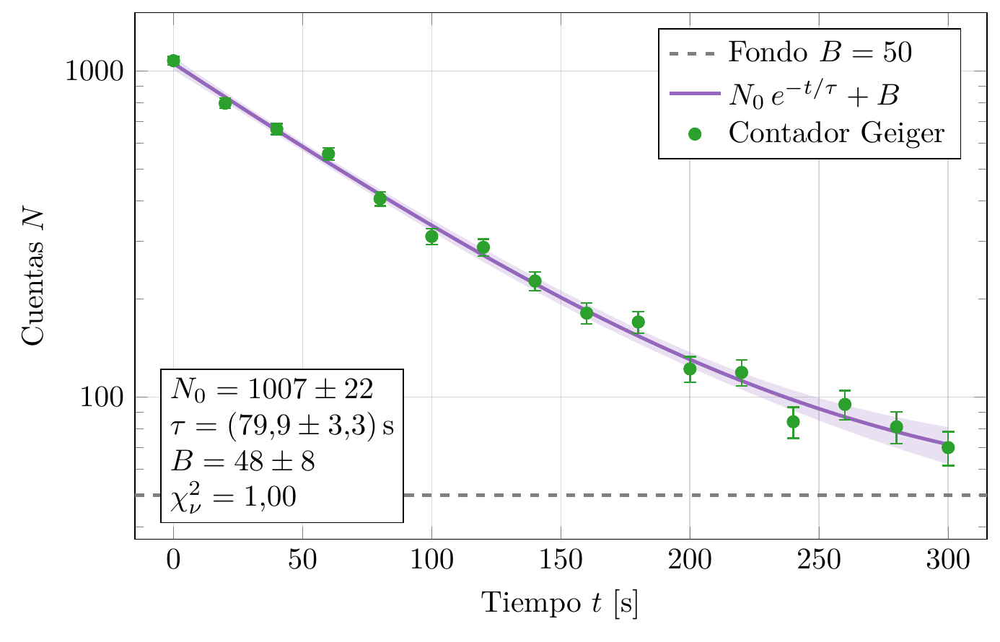

# FisGraf

> Manual completo de las tres herramientas: [../manual/MANUAL.md](../manual/MANUAL.md).

Gráficos de datos de física con calidad de publicación. FisGraf lee tus mediciones desde Excel, ajusta modelos teóricos con varios métodos numéricos, calcula la incertidumbre de cada parámetro y genera el gráfico con **LaTeX (pgfplots)**, así que todo el texto y las ecuaciones salen con tipografía LaTeX.




---

## 1. Requisitos

| Programa | Para qué | Comprobar |
|---|---|---|
| [Rust](https://rustup.rs) 1.85 o más nuevo | compilar FisGraf | `cargo --version` |
| [MiKTeX](https://miktex.org) o TeX Live | compilar los gráficos | `lualatex --version` |
| `pdftoppm` y `pdftocairo` (vienen con MiKTeX) | PNG, SVG y vista LaTeX | `pdftoppm -v` |

Paquetes LaTeX que se usan: `pgfplots`, `siunitx`, `amsmath`. Según la fuente elegida, también `newtx`, `newpx`, `libertine`, `XCharter` o `FiraSans`. MiKTeX instala los que falten la primera vez que se compila.

## 2. Abrir el programa

**Con el ejecutable:** haz doble clic en **`FisGraf.exe`**, en esta carpeta. Si no está, o si cambiaste el código, haz doble clic en **`crear_ejecutable.bat`**: compila la versión optimizada y deja `FisGraf.exe` listo. Para tener un acceso directo, haz clic derecho sobre `FisGraf.exe` → *Enviar a* → *Escritorio*. También puedes asociarle los archivos `.fisgraf.json` para abrirlos con doble clic.

**Desde la terminal:**

```bash
cargo run --release -p fisgraf -- datos_de_prueba/proyectos/01_caida_libre.fisgraf.json
```

Esta carpeta es parte de un workspace (ver el [README general](../README.md)). La calculadora de errores **FisErr** está en `../errores/`, y la herramienta de línea de comandos **`fisgraf-cli`** (que usa Claude) se compila desde aquí: `cargo build --release -p fisgraf --bin fisgraf-cli`.

**Para probar:** en **Archivo → Abrir datos de prueba** hay ocho experimentos con mediciones simuladas (caída libre, Ohm, RC, oscilador, enfriamiento, resonancia, efecto fotoeléctrico y Boyle). La guía está en [datos_de_prueba/README.md](datos_de_prueba/README.md).

## 3. Flujo de trabajo

La ventana tiene las **pestañas de configuración** a la izquierda, la **vista previa** en el centro y los **resultados y mensajes** abajo.

1. **Datos.** Abre tu Excel (`.xlsx`, `.xls`, `.ods`) y elige la hoja. En la tabla, haz clic en una celda y Mayús+clic en otra (o clic en la letra de una columna) para marcar un rango. Luego:
   - **→ x / → y / → σx / → σy** asigna el rango a la serie elegida.
   - **Crear serie con la selección** crea una serie a partir de 2 columnas (x, y) o 3 (x, y, σy), y toma el nombre del encabezado.
   - **Hasta el final de la columna** usa rangos como `B2:B`, que crecen si agregas filas.
2. **Series.** Cada serie es un conjunto de mediciones con su leyenda (LaTeX), color, marcador y barras de error. El error de x e y puede ser una columna del Excel, una constante, un porcentaje o la resolución del instrumento (σ = resolución/2√3).
3. **Ajustes.** Escribe la ecuación teórica, indica la variable medida y pulsa **Actualizar parámetros**. Para cada parámetro defines valor inicial, si queda fijo, límites, símbolo LaTeX y unidad. Después eliges el método de ajuste, el de incertidumbre y el estilo de la curva (banda de confianza incluida). En **Cuadro de resultados del gráfico** eliges qué escribir en el gráfico:
   - la **ecuación con los valores ajustados**, como la línea de tendencia de Excel: `y = 0,13 t + 4,935 t²`
   - los parámetros con su error
   - **R²**, R² ajustado, χ², χ²_red, p-valor, s de los residuos, n y ν, y un título

   **Agregar R² a la leyenda** escribe «(R² = 0,9998)» junto al nombre del ajuste.
4. **Referencias.** Curvas teóricas fijas, sin ajuste, para comparar. Los nombres sin valor se agregan como constantes.
5. **Ejes.** Título, límites manuales, escala lineal o logarítmica, marcas (automáticas, cada cierta distancia o en posiciones exactas `1; 2,5; 4`) y formato de los números (decimal o científico, decimales, coma decimal, separador de miles, factor ×10ⁿ).
6. **Estilo.** Tamaño y proporción (4:3, 16:9, 9:16, áurea o personalizada), fuente y tamaño de letra, motor LaTeX, cuadrícula, leyenda, cuadro de resultados, panel de residuos y preámbulo extra.
7. **Exportar.** PDF, PNG (con la resolución que elijas), SVG, `.tex` completo y un **fragmento `tikzpicture`** para pegar con `\input{}` en tu informe. **Copiar código tikzpicture** lo copia directo al portapapeles.

8. **Propagación.** Calculadora de errores, sin gráfico:
   - Escribe la ecuación de la magnitud (p. ej. `4*pi^2*L/T^2` para g) y pulsa **Detectar variables**.
   - Marca cada nombre como **variable medida** (valor, σ y distribución) o **constante** (sin error). Si dos mediciones no son independientes, indica su correlación ρ.
   - Elige el método. Obtienes el resultado redondeado según la GUM, el error relativo, la incertidumbre expandida, una **comparación de los cinco métodos**, el **presupuesto de incertidumbre** (qué medición aporta más error) y el histograma de Monte Carlo.
   - **Copiar fórmula de propagación** da en LaTeX σ_f = √(Σ (∂f/∂xᵢ)² σᵢ²) con las derivadas parciales explícitas.

**Vista previa:** la **Vista rápida** es instantánea y aproximada. La **Vista LaTeX** compila el gráfico real en segundo plano y tarda unos segundos.

**Resultados:** para cada ajuste se muestran los parámetros redondeados según la GUM, el intervalo de confianza, χ², χ²_red, p-valor, R², AIC/BIC y la matriz de correlación. **Copiar tabla LaTeX** genera una tabla lista para tu documento.

**Atajos:** Ctrl+N (nuevo), Ctrl+O (abrir), Ctrl+S (guardar), Ctrl+Mayús+S (guardar como), Ctrl+Z (deshacer) y Ctrl+Y (rehacer).

## 4. Escribir ecuaciones

Las ecuaciones se escriben con **sintaxis calculable**. FisGraf las convierte a LaTeX solo:

| Escribes | Se dibuja |
|---|---|
| `2*pi*sqrt(L/g)` | 2π√(L/g) |
| `A*exp(-t/tau) + B` | A e^(−t/τ) + B |
| `a*x^2 + b*x + c` | a x² + b x + c |
| `T0*sqrt(1 + (x/x0)^2)` | T₀ √(1 + (x/x₀)²) |

- Operadores: `+ - * / ^` (también `**`). La multiplicación puede quedar implícita: `2pi`, `2(x+1)`, `a(x-b)`.
- Funciones: `sin cos tan asin acos atan sinh cosh tanh exp ln log10 sqrt abs sign`, y `pow(a, b)`.
- Constantes: `pi` y `e`.
- **`log` es el logaritmo natural**, como en Python y C. Para base 10 usa `log10`.
- Nombres: `omega` → ω, `T_teo` → T_teo, `x0` → x₀. Si quieres otro símbolo, escríbelo en la columna «Símbolo LaTeX» del parámetro.
- Unidades con siunitx: `m/s^2`, `N/m`, `\kilo\gram`…

## 5. ¿Qué método elegir?

**Ajuste**

| Método | Úsalo cuando… |
|---|---|
| Automático | No sabes cuál elegir: decide según el modelo y los errores. |
| Mínimos cuadrados lineales | El modelo es lineal en los parámetros (rectas, polinomios). Da la solución exacta. |
| Levenberg–Marquardt | El caso general no lineal. |
| Gauss–Newton | El problema es sencillo y los valores iniciales son buenos. |
| Nelder–Mead + LM | Los valores iniciales están lejos de la solución. |
| Varianza efectiva | Hay errores en x y en y (lo habitual en laboratorio). |
| ODR | Hay errores en x e y comparables y quieres el tratamiento riguroso. |

**Incertidumbre**

| Método | Úsalo cuando… |
|---|---|
| Matriz de covarianza | Casi siempre. Elige el modo **absoluto** si tus σ son confiables, o **escalado por χ²_red** si no. |
| Bootstrap | No quieres suponer errores normales. |
| Monte Carlo | Quieres propagar los σ de tus mediciones (GUM‑S1). |
| Jackknife | Quieres ver cuánto depende el resultado de cada punto. |
| Perfil de χ² | El modelo es muy no lineal: da errores asimétricos −σ/+σ. |

**Propagación de errores**

| Método | Úsalo cuando… |
|---|---|
| Lineal (derivadas parciales) | Casi siempre: σ_f = √(Σ (∂f/∂xᵢ)² σᵢ²) más covarianzas. Es el método de la GUM. |
| Segundo orden | f es muy curva o los errores relativos son grandes: añade derivadas segundas y terceras. |
| Monte Carlo | Quieres el resultado más fiable sin suponer linealidad. Admite entradas uniformes o triangulares e intervalos asimétricos. |
| Kragten | Quieres el equivalente numérico del lineal (mover cada variable ±σ). Es el método de EURACHEM. |
| Cota máxima | Te piden el «error máximo» Σ\|∂f/∂xᵢ\|σᵢ. Es una cota del peor caso, no una σ. |

Si los métodos difieren mucho entre sí, f no es lineal en el rango de tus errores: confía en Monte Carlo.

**Cómo leer χ²_red:** si es ≈ 1, el modelo y los errores son coherentes. Si es ≫ 1, subestimaste los errores o el modelo no describe los datos. Si es ≪ 1, sobrestimaste los errores.

## 6. Ejemplos incluidos

En **Archivo → Abrir ejemplo**:

- **imanes**: réplica de un gráfico de informe, con dos funciones de referencia y datos medidos con Tracker.
- **pendulo**: T = 2π√(L/g) con errores en x e y, banda de confianza, cuadro de resultados y residuos. En la pestaña Propagación trae el cálculo de g = 4π²L/T² a partir de una medición.
- **hooke**: números escritos como texto con coma decimal en el Excel, error por resolución de la regla y fuente Palatino.
- **decaimiento**: N₀e^(−t/τ) + B con eje logarítmico y errores asimétricos por perfil de χ².

Los datos están en `examples/datos/ejemplo.xlsx`. Para regenerarlos:

```bash
cargo run --example generar_excel_ejemplo
```

## 7. Problemas frecuentes

- **«no se encontró lualatex»**: instala MiKTeX y reinicia FisGraf (o la terminal) para que se actualice el PATH.
- **La primera compilación tarda mucho o se queda esperando**: MiKTeX puede estar instalando paquetes o pidiendo permiso para hacerlo. Abre *MiKTeX Console* → *Settings* y elige «Always install missing packages».
- **«error de LaTeX en la línea N»**: hay un error en algún texto del gráfico (título, leyenda o etiqueta). Todo se interpreta como LaTeX: escribe `\%` en vez de `%` y `\_` fuera de modo matemático.
- **El ajuste no converge**: acerca los valores iniciales, prueba Nelder–Mead + LM o agrega límites a los parámetros.
- **«la celda Hoja1!B7 contiene “abc”, que no es un número»**: el rango incluye un encabezado o texto. Empieza el rango una fila más abajo.

## 8. Para desarrolladores

```bash
cargo test                              # pruebas, incluida la validación NIST
cargo test --test render -- --ignored   # las 7 fuentes con ambos motores (≈2 min)
cargo clippy --all-targets
```

- `src/data`: lectura de Excel y rangos.
- `src/model`: ecuaciones, derivadas simbólicas y LaTeX.
- `src/fit`: métodos de ajuste, validados con los 27 conjuntos de NIST StRD.
- `src/uncertainty`: métodos de incertidumbre, estadísticos y redondeo GUM.
- `src/propagation`: propagación de errores por los cinco métodos.
- `src/pipeline.rs`: del proyecto a la escena.
- `src/render`: pgfplots, compilación y exportación.
- `src/gui`: interfaz egui.

`PLAN.md` documenta la arquitectura y las decisiones de cada fase.
